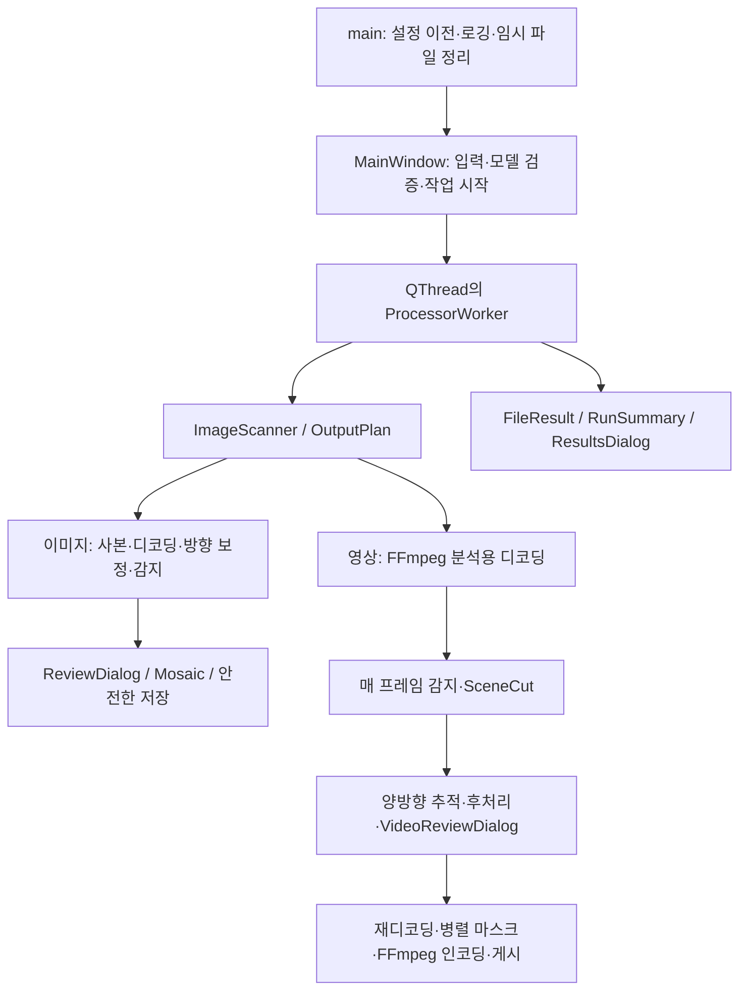
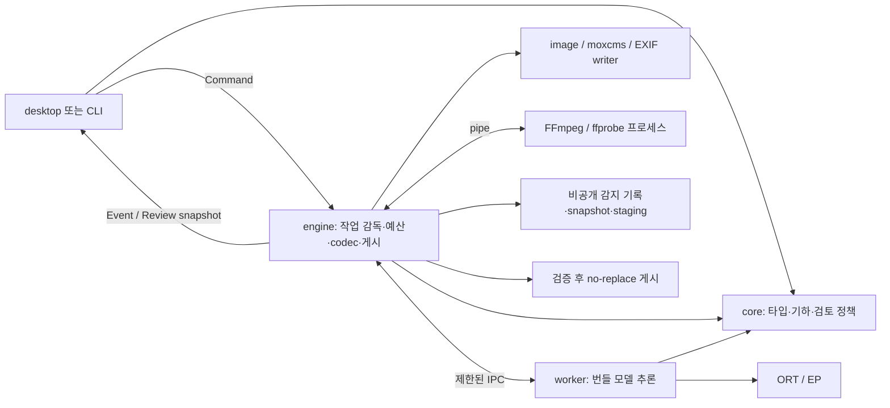

# CloakFrame Rust 전면 재설계 및 포팅 계획

작성일: 2026-10-15 (Asia/Seoul), 갱신: 2026-10-16(코드 대조 정정, 범위 축소·headless 우선·색 정책 반영, 레거시 C++ 유지보수 계획 제거). 분석 기준: CloakFrame 1.12.1, `735f63cda62a8b1753a3e82befd77c30fbe605bb`. 작성 당시 로컬 HEAD와 GitHub `main`이 같은 커밋임을 확인했다. 이 커밋은 `v1.12.1` 태그(`cedaafd`) 뒤의 문서 전용 커밋 2개를 포함하며 코드는 태그와 같다.

**레거시 정책:** 1.12.1이 기존 구현의 마지막 릴리스다. 기존 코드는 더 이상 수정·릴리스하지 않으며, 이 문서에서는 Rust 구현이 대체할 **동작의 근거**로만 쓴다. 기존 코드 링크는 위 분석 커밋에 고정한다.

**권고:** 독립된 Rust 애플리케이션을 **headless engine과 CLI부터** 완성하고, 1.12.1 동작에서 추출한 fixture와 2절 결함의 올바른 기대 결과로 검증한 뒤 desktop UI를 붙여 기존 배포판을 교체한다. 2절의 P0·P1 결함은 Rust 구현의 필수 요건으로 처음부터 반영한다. GUI는 egui/eframe(M0 spike로 확정), 추론은 ort + ONNX Runtime, 이미지 처리와 EXIF 작성은 Rust 구현, 동영상은 번들 FFmpeg 외부 프로세스를 사용한다. 안전한 출력 게시와 검토 상태를 핵심 도메인으로 만든다. 얼굴은 YOLO5Face-n·YuNet, 번호판은 YOLOv9-t의 해시로 고정된 번들 모델만 지원하고 **사용자 ONNX(SCRFD) 지원은 제거한다**. 추론은 GPU driver 장애를 격리하기 위해 별도 worker 프로세스에서 하지만, 신뢰하지 않는 모델을 실행하지 않으므로 첫 stable에 OS sandbox를 요구하지 않는다. Qt와 OpenCV를 제품 런타임에서 제거하되, 검증된 네이티브 라이브러리까지 무리하게 재작성하지 않는다.

**호환 범위:** 기존 사용자 이전은 CloakFrame만 대상으로 한다. Redactly는 지원을 종료한 레거시로 취급하며, 설정·모델 캐시·승인 기록·앱 ID·설치 및 업데이트 경로의 호환 계층을 구현하지 않는다. 아래의 Redactly 언급은 기존 구현 분석 또는 지원 제외 범위의 설명이다.

이 문서는 **설계와 실행 계획**이다. Rust 구현, 모델 변환, 성능 실험은 이번 작업에 포함하지 않았다. 아래 수치 중 새 구현의 목표는 측정 결과가 아니라 제안된 합격 기준이다. 라이브러리의 기능은 공식 문서로 확인했지만, CloakFrame 모델·패키지·GPU와의 조합은 아직 실행 검증하지 않았다.

## 1. 프로젝트 현황 및 기존(1.12.1) 아키텍처 분석

### 1.1 제품 요구사항과 현재 지원 범위

제품의 목적은 로컬 사진·동영상에서 얼굴과 차량 번호판을 찾아 가리고, 사용자가 결과를 검토·보완하여 별도 파일로 내보내는 것이다. 자동 감지는 누락 가능성이 있으므로, 처리 성공을 개인정보가 완전히 제거되었다는 보증으로 표현하면 안 된다.

현재 README의 배포 기준은 Windows 10 이상 x64, macOS 15 이상 Apple silicon, Linux x86_64/glibc 2.39 이상이다. 이미지 JPG/PNG/BMP/TIFF/WebP, 동영상 MP4/MOV/M4V/WebM의 H.264/HEVC/VP8/VP9 8-bit SDR, 출력 동영상 MP4 H.264/HEVC를 지원한다. HDR·10-bit 동영상은 처리 대상이 아니다. 영어·한국어·일본어와 자동 업데이트를 제공한다. [README](../README.md) README에 없지만 코드상 다중 페이지·애니메이션 이미지는 거부하며, 밝음·어두움·시스템 테마를 제공한다. [프레임 수 검사](https://github.com/nyabi-gh/CloakFrame/blob/735f63cda62a8b1753a3e82befd77c30fbe605bb/src/ImageIo.cpp#L1613), [테마 설정](https://github.com/nyabi-gh/CloakFrame/blob/735f63cda62a8b1753a3e82befd77c30fbe605bb/src/main.cpp#L140)

유지해야 할 요구사항과 교체 가능한 구현을 구분한다.

| 유지할 요구사항 | 현재 구현일 뿐인 선택 |
| --- | --- |
| 원본 보존, 로컬 처리, 무단 덮어쓰기 금지 | Qt의 파일·네트워크·스레드 API |
| 얼굴·번호판 감지, 수동 추가·제외, 경고를 확인하는 검토 | 모든 대상을 `FaceDetection`으로 표현 |
| Windows/macOS GPU 및 항상 가능한 CPU 처리 | DirectML/CoreML의 현재 세션 옵션과 라이브러리 버전 |
| 대용량 작업의 취소·실패 처리 | 전체 동영상 감지·추적 데이터를 RAM에 보관 |
| 안정적인 영상·오디오 타임라인 | rawvideo 파이프와 CFR 정규화의 구체적인 필터 문자열 |
| 모자이크·블러·불투명 채움·사용자 이미지 | 최대 12셀 모자이크, 현재 블러 커널 계산식 |
| 메타데이터 기본 제거와 명시적 선택 보존 | OpenCV 재인코딩, 보존 선택 시 원본 ExifData 사본에서 allowlist 밖 항목을 지우는 방식 |
| 업데이트의 출처·무결성 검증 | Qt updater 래퍼, 현재 CI의 의존성 설치 방법 |

### 1.2 실제 의존성과 실행 흐름

`cloakframe_core`라는 정적 라이브러리가 있지만 UI 독립 코어는 아니다. Qt Core/Gui/Network, OpenCV, ORT, spdlog, libsodium(조건부로 Exiv2, Windows의 advapi32)을 공개 의존성으로 노출하며 `QObject`, `QString`, `cv::Mat`이 처리 인터페이스에 등장한다. core 안에서 `QImage`는 `ProcessorWorker`의 검토 preview 생성과 전달에 쓰이고, core 밖에서는 `MainWindow`·검토 dialog·`ThumbnailLoader`가 쓴다. `ProcessorWorker`도 이 코어에 포함된다. [빌드 구성](https://github.com/nyabi-gh/CloakFrame/blob/735f63cda62a8b1753a3e82befd77c30fbe605bb/src/CMakeLists.txt), [처리 인터페이스](https://github.com/nyabi-gh/CloakFrame/blob/735f63cda62a8b1753a3e82befd77c30fbe605bb/include/cloakframe/ProcessorWorker.hpp)



### 1.3 영역별 분석과 재설계 판단

| 영역 | 실제 구현과 장점 | 한계·판단 및 Rust에서의 방향 |
| --- | --- | --- |
| GUI·사용자 상호작용 | Qt Widgets, 드래그앤드롭, 폴더 입력, 고급 설정, 상태·진행률·결과 목록. `MainWindow.cpp` 약 3,070행에서 검증·모델 캐시·설정·업데이트·검토까지 조정 | 데스크톱 동작과 접근성 작업은 자산. 실행 전 검증을 서비스로 이동하고 UI는 명령·상태 표시만 담당. [MainWindow](https://github.com/nyabi-gh/CloakFrame/blob/735f63cda62a8b1753a3e82befd77c30fbe605bb/src/MainWindow.cpp) |
| 이미지 입출력 | 확장자 스캔 뒤 실제 컨테이너 확인, 비공개 원본 사본, Qt로 크기·프레임 수 검사, OpenCV 디코딩·인코딩, EXIF 방향 정규화, 메모리 예약, 원본 식별자 검사 | 안전 검사는 유지. 중복 파싱과 서로 다른 디코더의 지원 차이를 줄인다. 16-bit/alpha와 방향을 명시적 타입·포맷 계약으로 관리. [이미지 처리](https://github.com/nyabi-gh/CloakFrame/blob/735f63cda62a8b1753a3e82befd77c30fbe605bb/src/ProcessorWorker.cpp#L987), [ImageIo](https://github.com/nyabi-gh/CloakFrame/blob/735f63cda62a8b1753a3e82befd77c30fbe605bb/src/ImageIo.cpp) |
| 얼굴 감지 | YOLO5Face-n 640 입력, SCRFD 다중 출력/stride 해석·landmark(사진 640, 영상 960 입력), YuNet 640 입력. 네 감지기 모두 추론 락. 전처리·추론·후처리 시간 측정은 YOLO5Face와 번호판만 | **추론에 OpenCV `FaceDetectorYN`을 쓰는 것은 YuNet뿐**이고 YuNet은 GPU 옵션이 없는 CPU 전용이다. YOLO와 번호판도 전처리에 `cv::dnn::blobFromImage`를 쓰므로 OpenCV 제거 시 함께 대체한다. ORT로 통합하려면 YuNet 원시 출력 해석을 새로 검증해야 한다. 모델별 전처리·출력 계약을 공통 인터페이스 뒤에 둔다. SCRFD(사용자 모델)는 Rust에서 지원하지 않는다. [YOLO](https://github.com/nyabi-gh/CloakFrame/blob/735f63cda62a8b1753a3e82befd77c30fbe605bb/src/Yolo5FaceDetector.cpp#L217), [SCRFD](https://github.com/nyabi-gh/CloakFrame/blob/735f63cda62a8b1753a3e82befd77c30fbe605bb/src/ScrfdFaceDetector.cpp), [YuNet](https://github.com/nyabi-gh/CloakFrame/blob/735f63cda62a8b1753a3e82befd77c30fbe605bb/src/YuNetFaceDetector.cpp#L110), [영상 입력 크기](https://github.com/nyabi-gh/CloakFrame/blob/735f63cda62a8b1753a3e82befd77c30fbe605bb/src/ProcessorWorker.cpp#L1514) |
| 번호판 감지 | YOLOv9-t end-to-end ONNX, 통상 512 입력, letterbox·출력 텐서 검사 | 얼굴 결과와 합칠 때 종류가 사라진다. 종류·모델·관측 출처를 유지하고 NMS/추적을 종류별로 수행. [PlateDetector](https://github.com/nyabi-gh/CloakFrame/blob/735f63cda62a8b1753a3e82befd77c30fbe605bb/src/PlateDetector.cpp), [FaceDetection](https://github.com/nyabi-gh/CloakFrame/blob/735f63cda62a8b1753a3e82befd77c30fbe605bb/include/cloakframe/FaceDetection.hpp) |
| 모델 관리 | URL·SHA-256·예상 크기 카탈로그, 첫 사용 다운로드 동의, 재시도·크기/시간 제한, 원자적 캐시 저장, 사용자 모델 digest+size 동의. 모델 경로는 CloakFrame cache, Redactly cache, `앱/models`, macOS 번들 `Resources/models`, 개발 경로, `cwd/models`의 6개 후보를 차례로 탐색한다. 실행 시작 시 MainWindow가 번들 모델 digest를 비교하고, 각 감지기가 읽은 bytes를 다시 hash한 뒤 그 bytes로 세션을 만든다 | 상당 부분 유지할 정책. 특히 hash한 bytes로 세션을 만드는 방식(경로 재오픈 없음)은 TOCTOU 방지 계약으로 유지. 다운로드는 Qt 수신 버퍼를 64KB로 제한할 뿐 본문 전체를 `QByteArray` 하나에 누적한 뒤 hash하고(상한 `max(예상 크기×4, 64MB)`), ModelStore가 임시 파일에 쓴 뒤 디스크에서 다시 hash한다. 메모리 사본은 하나지만 모델 크기만큼 RAM을 쓴다. [후보 경로](https://github.com/nyabi-gh/CloakFrame/blob/735f63cda62a8b1753a3e82befd77c30fbe605bb/src/ModelCatalog.cpp#L32) ONNX 파싱은 메인 프로세스 내부이며 SCRFD용 자체 protobuf graph patcher까지 있다. 다운로드를 디스크로 스트리밍하고 hash한 바이트만 추론 worker로 전달. 사용자 모델 동의·graph patcher는 사용자 ONNX 지원과 함께 제거. [카탈로그](https://github.com/nyabi-gh/CloakFrame/blob/735f63cda62a8b1753a3e82befd77c30fbe605bb/src/ModelCatalog.cpp#L29), [다운로드](https://github.com/nyabi-gh/CloakFrame/blob/735f63cda62a8b1753a3e82befd77c30fbe605bb/src/ModelDownload.cpp#L51), [저장](https://github.com/nyabi-gh/CloakFrame/blob/735f63cda62a8b1753a3e82befd77c30fbe605bb/src/ModelStore.cpp), [patcher](https://github.com/nyabi-gh/CloakFrame/blob/735f63cda62a8b1753a3e82befd77c30fbe605bb/src/OnnxGraphPatch.cpp) |
| GPU·CPU 폴백 | macOS CoreML MLProgram/캐시, Windows DirectML 순차 실행·메모리 패턴 비활성화. Linux CUDA/MIGraphX/ROCm 탐색 코드. 로드·warmup 중 ORT 오류 시 CPU 세션 재생성, 작업 중 실패 시 같은 이미지/프레임을 CPU로 한 번 재실행하고 이후 run 전체를 CPU로 처리. 두 폴백 모두 `Ort::Exception`만 잡으므로 `std::bad_alloc` 같은 다른 예외는 폴백되지 않는다. YuNet은 가속 대상이 아님. 사용자 모델(SCRFD)도 GPU 설정을 그대로 따른다 | 공식 Linux 패키지는 CPU ORT이므로 GPU 탐색 코드 존재가 배포 기능을 뜻하지 않는다. 같은 작업을 CPU에서 다시 처리하는 정책은 유지하되, 폴백 대상 오류의 범위(EP 오류·GPU 메모리 부족·worker 종료)를 명시적으로 정한다. EP 등록과 실제 GPU 노드 실행은 따로 측정. [OrtAcceleration](https://github.com/nyabi-gh/CloakFrame/blob/735f63cda62a8b1753a3e82befd77c30fbe605bb/src/OrtAcceleration.cpp), [폴백](https://github.com/nyabi-gh/CloakFrame/blob/735f63cda62a8b1753a3e82befd77c30fbe605bb/src/ProcessorWorker.cpp#L479), [release](https://github.com/nyabi-gh/CloakFrame/blob/735f63cda62a8b1753a3e82befd77c30fbe605bb/.github/workflows/release.yml) |
| 익명화 | 모자이크·블러·검정 채움·사용자 이미지, 사각/타원, padding·soft edge. 사용자 이미지 아래 모자이크, landmark 기반 roll, 타원 모서리와 가는 ROI 보완 | geometry 회귀 테스트는 유지. 식별 방지 강도는 별도 평가. 불투명 채움을 안전 기본값으로 제안하며 기존 방식은 유지한다. [Mosaic](https://github.com/nyabi-gh/CloakFrame/blob/735f63cda62a8b1753a3e82befd77c30fbe605bb/src/Mosaic.cpp) |
| 동영상 입출력 | QProcess FFmpeg/ffprobe, 로컬 파일 protocol 제한, raw BGR, 선읽기·버퍼 재사용, 분석(긴 변 960 축소)/인코딩 2패스. 인코딩 전 하드웨어 인코더 probe, 인코딩 중 실패 시 인코딩 패스만 소프트웨어로 재시작. rotation은 pixel에 반영하고 odd size는 오른쪽·아래 1px crop | VFR은 `setpts`+`fps`로 CFR화하지만 검토 preview는 `-copyts`+`fps(start_time)`+`select(t)`의 다른 필터 경로로 float 초 기준 프레임을 고른다. 기준점도 다르다. 분석은 첫 frame PTS(`STARTPTS`)로, preview는 ffprobe stream `start_time`으로 맞추므로 edit list·B-frame으로 둘이 다르면 검토 frame이 한 칸 어긋날 수 있다. 오디오는 `start_time`이 양수일 때만 `-ss`를 적용하고 `-t`(stream duration, 없으면 format duration)로 자르며, CFR 변환으로 frame 수가 바뀌어도 보정하지 않는다. 비트스트림·색 정보·오디오 동기화 검증이 필요. [preview 기준점](https://github.com/nyabi-gh/CloakFrame/blob/735f63cda62a8b1753a3e82befd77c30fbe605bb/src/VideoIo.cpp#L543), [오디오 trim](https://github.com/nyabi-gh/CloakFrame/blob/735f63cda62a8b1753a3e82befd77c30fbe605bb/src/VideoIo.cpp#L1160) 두 패스 계약은 유지하되 시간축을 하나의 값으로 공유. [VideoIo](https://github.com/nyabi-gh/CloakFrame/blob/735f63cda62a8b1753a3e82befd77c30fbe605bb/src/VideoIo.cpp#L709), [인코더 probe](https://github.com/nyabi-gh/CloakFrame/blob/735f63cda62a8b1753a3e82befd77c30fbe605bb/src/VideoIo.cpp#L293), [SW 재시도](https://github.com/nyabi-gh/CloakFrame/blob/735f63cda62a8b1753a3e82befd77c30fbe605bb/src/VideoProcessor.cpp#L1049), [preview 선택](https://github.com/nyabi-gh/CloakFrame/blob/735f63cda62a8b1753a3e82befd77c30fbe605bb/src/VideoReviewTypes.cpp#L135) |
| 추적·장면 전환 | 고/저 점수 2단계 greedy IoU와 속도 예측, 앞/뒤 추적 병합, 보간·평활화·끝 연장·cut 경계 보정. SceneCut은 48×27 회색조 차이·최근 중앙값·후속 2프레임 확인 | 이름이 `ByteTracker`여도 표준 ByteTrack의 Kalman 필터·선형 할당(LAPJV) 구현과 같지 않다. 보간 box는 이미 `interpolated`로 구분되어 검토 UI까지 전달된다. 평활화는 **관측 box**에 대해서만 원래 box와의 합집합을 쓰며, 합집합 면적이 1.25배를 넘으면 원래 box로 되돌린다. 보간 box에는 합집합을 쓰지 않아 평활화로 줄어들 수 있다. SceneCut은 후보 확정을 기다리는 2프레임 동안 새 spike를 평가하지 않아 그 안의 두 번째 cut을 놓친다(코드 주석에 명시). 보간 구분은 유지하고, 관측·보간 모두 평활화가 보호 영역을 줄이지 않도록 바꾸면서 종류별 연관·짧은 구간 처리·명시적 불확실성으로 재설계. [Tracking](https://github.com/nyabi-gh/CloakFrame/blob/735f63cda62a8b1753a3e82befd77c30fbe605bb/src/Tracking.cpp), [SceneCut](https://github.com/nyabi-gh/CloakFrame/blob/735f63cda62a8b1753a3e82befd77c30fbe605bb/src/SceneCut.cpp) |
| 병렬·메모리·취소 | 비검토 이미지는 `processOrdered`, 검토는 직렬, 영상 파일은 직렬. 감지 세션 락, 분석 decoder thread, 마스크 pool, RAM 기반 예산·안전 상한·atomic 취소 | 순서·backpressure·버퍼 회수는 유지. 스캔은 취소 콜백이 없고, ORT·OpenCV·별도 pool이 중첩된다. 영상은 전체 frame의 detections를 쌓은 뒤 앞뒤 tracks를 만들고 최종 frame 색인으로 옮긴다. 색인 변환 중 tracks는 즉시 해제하므로 최고점은 detections와 양방향 tracks가 함께 있는 추적 단계다. RAM은 길이에 비례해 늘고, detection 예산(물리 RAM/32, 128–512MB)·frame 300만·tracked box(양방향 합 16M, 패스당·최종 각 8M)·region 8M·프레임당 감지 256개·active track 4,096·track 65,536 상한을 넘으면 작업이 실패한다. 추적 단계는 `std::exception` 전체를 잡아 `bad_alloc`도 “safety limit” 메시지로 바꾼다. 같은 상한 초과라도 사진의 감지기 cap 초과(omitted)는 경고 후 게시하고 영상의 프레임당 256개 초과는 작업 실패여서 처리가 정반대다. [OrderedParallel](https://github.com/nyabi-gh/CloakFrame/blob/735f63cda62a8b1753a3e82befd77c30fbe605bb/include/cloakframe/OrderedParallel.hpp), [MemoryBudget](https://github.com/nyabi-gh/CloakFrame/blob/735f63cda62a8b1753a3e82befd77c30fbe605bb/src/MemoryBudget.cpp), [Scanner](https://github.com/nyabi-gh/CloakFrame/blob/735f63cda62a8b1753a3e82befd77c30fbe605bb/include/cloakframe/ImageScanner.hpp) |
| 이미지 검토 | 자동 영역 선택·해제, 수동 영역, undo/redo, 키보드 편집, 저장·건너뛰기·원본 복사·전체 취소 | 최대 크기로 축소한 preview와 좌표 역변환, blocking queued 호출에 의존. 원본 좌표 편집 모델·비동기 검토·전체 해상도 확대를 도입. [ReviewDialog](https://github.com/nyabi-gh/CloakFrame/blob/735f63cda62a8b1753a3e82befd77c30fbe605bb/src/ReviewDialog.cpp), [preview 생성](https://github.com/nyabi-gh/CloakFrame/blob/735f63cda62a8b1753a3e82befd77c30fbe605bb/src/ProcessorWorker.cpp#L310) |
| 영상 검토·결과 | 트랙 제외, 수동 keyframe·시작/끝, 누락 구간 이동·확인, 결과에서 재검토. 요청별 FFmpeg preview 프로세스와 16프레임 캐시 | 마스크 적용 재생, 지속 재생, 저장 후 재개는 ROADMAP의 미완료 항목. 확인했다는 사실과 실제 마스크 적용을 분리하고 동일 renderer로 preview/export. [VideoReview](https://github.com/nyabi-gh/CloakFrame/blob/735f63cda62a8b1753a3e82befd77c30fbe605bb/src/VideoReviewDialog.cpp#L1156), [Results](https://github.com/nyabi-gh/CloakFrame/blob/735f63cda62a8b1753a3e82befd77c30fbe605bb/src/ResultsDialog.cpp), [ReviewTypes](https://github.com/nyabi-gh/CloakFrame/blob/735f63cda62a8b1753a3e82befd77c30fbe605bb/src/VideoReviewTypes.cpp) |
| 설정·로깅·다국어 | QSettings, Redactly 설정 키 일괄 복사(1회, marker 기록), 모델 digest 승인 기록. spdlog 회전 로그는 기본 상세 기록 OFF, stdout도 같은 정책. 단 시작·실행 결과 집계 같은 진단 로그는 항상 기록. Qt TS 번역 완결성 검사 | 현재 CloakFrame 설정만 키별 이전하고 Redactly fallback은 재구현하지 않는다. 경로·파일명 없는 구조화 이벤트로 전환하고 경고는 오류 코드와 UI 번역으로 전달. [main](https://github.com/nyabi-gh/CloakFrame/blob/735f63cda62a8b1753a3e82befd77c30fbe605bb/src/main.cpp), [설정](https://github.com/nyabi-gh/CloakFrame/blob/735f63cda62a8b1753a3e82befd77c30fbe605bb/src/MainWindow.cpp#L2102), [Logging](https://github.com/nyabi-gh/CloakFrame/blob/735f63cda62a8b1753a3e82befd77c30fbe605bb/src/Logging.cpp), [번역 검사](https://github.com/nyabi-gh/CloakFrame/blob/735f63cda62a8b1753a3e82befd77c30fbe605bb/scripts/check_translations.py) |
| 업데이트·배포 | Windows/Linux Velopack, macOS Sparkle. libsodium Ed25519 서명은 channel/version/filename/digest 포함. 빌드와 서명 job 분리, 네이티브 의존성과 FFmpeg hash 고정. Sparkle 2.9.4 고정 | 업데이트 계약은 유지하고 Rust 어댑터로 교체. ROADMAP은 서명 secret 8개가 아직 repository 범위라고 기록한다. 공개 키 없이 빌드한 Windows/Linux 앱은 `Unpinned` 분기에서 업데이트를 검증 없이 수락하며 태그 빌드의 CI 실패로만 막고, macOS는 Sparkle 키가 없어도 CMake 경고만 낸다. macOS feed 서명·실시간 opt-out·키 순환을 보강. [Unpinned](https://github.com/nyabi-gh/CloakFrame/blob/735f63cda62a8b1753a3e82befd77c30fbe605bb/src/SelfUpdaterVelopack.cpp#L221) [서명](https://github.com/nyabi-gh/CloakFrame/blob/735f63cda62a8b1753a3e82befd77c30fbe605bb/src/UpdateSignature.cpp), [Velopack](https://github.com/nyabi-gh/CloakFrame/blob/735f63cda62a8b1753a3e82befd77c30fbe605bb/src/SelfUpdaterVelopack.cpp), [Sparkle](https://github.com/nyabi-gh/CloakFrame/blob/735f63cda62a8b1753a3e82befd77c30fbe605bb/src/SelfUpdaterSparkle.mm), [릴리스 운영](RELEASING.md) |
| 파일 안전·개인정보 | 루트 기준 게시, symlink/reparse 방어, no-replace, 비공개 staging, 원본 snapshot, 재시작 시 stale stage 정리, Release crash dump 억제. EXIF allowlist·GPS 별도 선택, 영상 subtitle/data/chapter 제거 | 그대로 재검증해야 할 핵심 자산. Rust `rename` 또는 `tempfile`만으로 모두 대체할 수 없다. 저장 성공·검토 필요·원본 복사를 타입에서 구별. crash dump 억제의 테스트는 아직 없다. [ImageIo](https://github.com/nyabi-gh/CloakFrame/blob/735f63cda62a8b1753a3e82befd77c30fbe605bb/src/ImageIo.cpp#L1668), [StageCleanup](https://github.com/nyabi-gh/CloakFrame/blob/735f63cda62a8b1753a3e82befd77c30fbe605bb/src/StageCleanup.cpp), [crash dump](https://github.com/nyabi-gh/CloakFrame/blob/735f63cda62a8b1753a3e82befd77c30fbe605bb/src/main.cpp#L64) |

오디오는 기본 보존되며 익명화 대상이 아니다. 모든 오디오 트랙을 첫 비디오 구간에 맞춰 매핑하고 MP4 호환 코덱(aac/mp3/ac3/eac3/alac)은 복사, 나머지는 AAC로 변환하며 언어만 선별 복원한다. 사용자는 오디오 전체 제거를 선택할 수 있다. 이것을 “개인정보가 모두 제거된 영상”으로 표시해서는 안 된다. 현재 코드도 음성 미익명화 메시지를 제공한다. [audio mux](https://github.com/nyabi-gh/CloakFrame/blob/735f63cda62a8b1753a3e82befd77c30fbe605bb/src/VideoIo.cpp#L1160), [언어 복원](https://github.com/nyabi-gh/CloakFrame/blob/735f63cda62a8b1753a3e82befd77c30fbe605bb/src/VideoIo.cpp#L1214), [결과 메시지](https://github.com/nyabi-gh/CloakFrame/blob/735f63cda62a8b1753a3e82befd77c30fbe605bb/src/ProcessorWorker.cpp#L1797)

### 1.4 테스트·CI 및 알려진 문제의 신뢰 수준

- CMake 3.24+, C++23, Ninja presets, CTest와 Qt Test를 사용한다. 테스트 실행 파일은 17개이며 Python이 있을 때 등록되는 번역 검사가 별도로 있다. 테스트 대상은 Release에서도 assert를 활성화한다(앱 Release는 NDEBUG 유지). 파일 게시·메타데이터·모델 승인·다운로드·취소·추적·검토·업데이트 서명에 실제 회귀 테스트가 있다. [tests/CMakeLists.txt](https://github.com/nyabi-gh/CloakFrame/blob/735f63cda62a8b1753a3e82befd77c30fbe605bb/tests/CMakeLists.txt)
- CI는 정적 검사, macOS Clang-Tidy, 세 OS 빌드/테스트다. YOLO5Face·YuNet·번호판 모델 3종과 얼굴 샘플을 hash 고정으로 내려받는다. SCRFD 모델은 받지 않으므로 실제 SCRFD 모델 추론 테스트는 CI에서 건너뛴다. 합성 모델로 하는 graph patcher 테스트와 SCRFD hash 거부 테스트는 실행된다. GPU parity(YOLO만)는 가속 장치가 없으면 건너뛰며, macOS runner에서 CoreML EP가 붙으면 실행될 수 있다. macOS Clang-Tidy job은 `brew install onnxruntime`으로 버전이 고정되지 않은 ORT를 쓴다. 번호판은 빈 이미지 추론만으로 실제 번호판 재현율을 검증하지 못한다. FFmpeg 테스트도 도구 부재 시 skip 가능하다. [모델 fixture](https://github.com/nyabi-gh/CloakFrame/blob/735f63cda62a8b1753a3e82befd77c30fbe605bb/.github/scripts/fetch_test_models.sh), [SCRFD 테스트](https://github.com/nyabi-gh/CloakFrame/blob/735f63cda62a8b1753a3e82befd77c30fbe605bb/tests/test_core.cpp#L2900), [번호판 테스트](https://github.com/nyabi-gh/CloakFrame/blob/735f63cda62a8b1753a3e82befd77c30fbe605bb/tests/test_core.cpp#L3091), [CI](https://github.com/nyabi-gh/CloakFrame/blob/735f63cda62a8b1753a3e82befd77c30fbe605bb/.github/workflows/ci.yml)
- GitHub의 기준 커밋 [CI 실행](https://github.com/nyabi-gh/CloakFrame/actions/runs/37427950523)은 성공했다. [1.12.1 Release 실행](https://github.com/nyabi-gh/CloakFrame/actions/runs/37302973677)의 macOS·업데이트 서명 job도 성공 상태였다. 이는 이번 작업에서 패키지를 직접 설치·실행했음을 뜻하지 않는다.
- 조회 시 열린 GitHub issue는 0건이었다. 알려진 작업은 [ROADMAP](ROADMAP.md), [CHANGELOG](../CHANGELOG.md), 코드·테스트로 판단한다. ROADMAP의 “sign jobs가 실행되지 않았다”는 기록은 위 실행 상태와 다르므로 현재 사실로 반복하지 않는다. secret 범위, 실제 최소 OS 실행, GPU 사용, 패키지 수동 시험 여부는 별도 확인 대상이다.
- 이번 분석에서는 전체 소스 트리·헤더·빌드·테스트·workflow·배포 스크립트를 조사하고 주요 데이터 경로를 추적했다. 새 빌드나 성능 측정을 수행하지 않았으므로 아래 개선 기회는 **정적 분석과 문서 근거에 따른 판단**이다.

## 2. 현재 구현의 문제점과 개선 기회

| 우선순위 | 근거·문제 | 재설계 조치와 사용자 영향 |
| --- | --- | --- |
| P0 | `ProcessorWorker`가 출력을 저장·게시한 다음 omitted/gap/drop 등의 경고를 집계한다. omitted 수와 미해결 구간은 저장 전에 이미 알고 있다. 정상 폴더에 파일은 있으나 `NeedsReview`일 수 있다. `NeedsReview`에는 트랙 제외·원본 복사·영역 0개·metadata 복사 실패처럼 사용자의 명시적 결정이나 비감지 사유도 섞여 있다. 영상에서 metadata 보존 설정이 켜져 있으면 “영상은 보존 불가” 경고로 모든 영상이 `NeedsReview`가 된다 | 자동 감지의 미해결 문제(omitted, dropped track, 미확인 gap)가 있으면 정상 출력 게시를 막는다. 사용자가 검토에서 명시적으로 결정한 항목은 차단하지 않고 결과에 적용 범위로 표시한다. 검토 작업으로 보관하거나 별도 명시적 예외 내보내기를 제공. 자동 배치에서 결과가 바로 생기지 않을 수 있음을 안내. [저장 후 경고](https://github.com/nyabi-gh/CloakFrame/blob/735f63cda62a8b1753a3e82befd77c30fbe605bb/src/ProcessorWorker.cpp#L1418), [상태 결정](https://github.com/nyabi-gh/CloakFrame/blob/735f63cda62a8b1753a3e82befd77c30fbe605bb/src/ProcessorWorker.cpp#L803) |
| P0 | 사용자 승인·해시 일치는 출처/바이트 확인이지 ONNX의 안전성 증명이 아니다. 신뢰하지 않는 사용자 SCRFD 모델을 ORT와 자체 graph patcher가 앱 프로세스 안에서 파싱한다. patcher는 입력과 Resize sizes를 요청 크기(사진 640, 영상 960)로 다시 쓰며, ROADMAP은 patcher가 파일 크기보다 훨씬 큰 할당을 할 수 있다고 기록한다 | **사용자 ONNX 지원을 제거한다.** 번들 모델만 실행하므로 신뢰하지 않는 모델의 sandbox, graph patch, 사용자 모델 동의가 모두 필요 없어진다. SCRFD를 쓰던 사용자는 YOLO5Face-n 또는 YuNet으로 옮겨야 하며, 이를 동작 변경 장부와 첫 실행 안내에 기록한다 |
| P0 | `FaceDetection`에 종류가 없고 face+plate 결과가 같은 추적기로 들어간다. NMS는 감지기 내부에서만 수행하므로 혼합되는 것은 추적 연관이다. 영상 감지 임계값 `min(0.1, scoreThreshold)`가 번호판에도 적용되어, 낮은 점수의 번호판 후보가 low-score 단계에서 얼굴 track을 연장하거나 그 반대가 될 수 있다 | `DetectionKind`를 끝까지 보존. cross-class 연관 금지. 잘못된 트랙·검토 분류 위험을 예방하되 실제 발생률은 미측정 |
| P1 | 큰 사진도 얼굴 640·번호판 512 단일 입력으로 줄인다(타일링 없음). 영상은 분석 해상도를 긴 변 960으로 먼저 줄이고, 얼굴 모델은 SCRFD만 960·나머지 640, 번호판은 512 입력 | 전체 보기+겹치는 타일 감지, 작은 객체 평가셋, 품질 preset. 처리 시간 증가는 명시적으로 측정 |
| P1 | 영상의 전체 detections와 양방향 tracks가 RAM에 쌓이고, 고정 상한을 넘는 긴 영상은 실패한다 | 감지·track 결과를 디스크 레코드 파일에 쓰고 active track만 메모리에 두되 전체 양방향 추적은 유지(5.4절), preview cache도 byte 예산. 긴 영상에서 RAM이 길이에 비례하지 않게 하고 현재 상한 때문에 실패하던 길이도 처리 |
| P1 | 모자이크 셀 수·블러 결과는 픽셀이 변했다는 사실만 입증 | 기본 불투명 채움, track에 고정된 grid·강도, 얼굴 재식별/OCR 공격 평가. 기존 모자이크·블러 선택 유지 |
| P1 | 검토 preview/작업 호출이 Qt 객체 생명주기와 동기 invoke에 결합 | 명령/이벤트와 검토 revision. UI가 사라지거나 취소되면 pending review 해제, 저장 불가 |
| P1 | VFR→CFR, 비정방 픽셀, odd size crop, rotation 처리가 서로 다른 경로에 존재. 특히 분석은 `setpts+fps`, 검토 preview는 `-copyts+fps(start_time)+select(t)`로 서로 다른 필터 경로에서 frame을 고른다 | 단일 타임라인·기하 변환 계약. odd size는 crop 대신 pad를 기본으로 바꿔 가장자리 픽셀 보존. 원본 VFR 보존은 별도 범위 |
| P1 | OpenCV로 재인코딩하는 모든 익명화 출력이 원본 ICC를 잃는다(EXIF 보존 경로는 명시적으로 ICC를 비운다). `Copy Original`은 metadata 보존이 켜져 있으면 경고 후 원본 바이트를 그대로 복사하므로 GPS 선택과 무관하게 **원본 메타데이터 전체**(GPS·XMP 포함)와 ICC가 남고, 꺼져 있으면 바이트 복사가 아니라 메타데이터 없는 재인코딩이다. ICC가 사라지므로 Display P3 등 넓은 색역 사진(iPhone 기본)은 sRGB로 해석되어 색이 바랜다. [원본 복사](https://github.com/nyabi-gh/CloakFrame/blob/735f63cda62a8b1753a3e82befd77c30fbe605bb/src/ProcessorWorker.cpp#L1315) | 색 변환 후 안전한 표준 색 정보만 생성. 원본 복사는 명시적 비익명화 내보내기로 분리. 기존 동작을 숨은 버그로 단정하지 않음 |
| P1 | 공개 키 없이 빌드된 Windows/Linux 앱은 업데이트 서명을 검증하지 않고 수락한다. 태그 빌드의 CI 실패만이 이를 막고 macOS는 키 누락이 경고뿐이다. 다운그레이드·replay 방지를 위한 버전 기록이 없다 | 공식 빌드에서 키 누락을 compile/build 오류로 만들고, 런타임에도 키가 없으면 업데이트를 거부. 최고 수신/설치 버전을 기록 |
| P1 | Qt/OpenCV/ORT/Exiv2/FFmpeg의 플랫폼별 조합과 플러그인·서명 후 hash가 복잡 | Qt/OpenCV 제거, 네이티브 자산 manifest 단일화, 최종 서명 바이트로 hash 재생성, 패키지 자체 시험 |
| P1 | 고유 보안 테스트는 많지만 실제 누락률·시간/메모리 기준, sanitizer/fuzz가 부족 | 기존 합성 회귀셋 보존 + 독립 라벨셋 + 실패 주입 + GPU 실기기 gate |
| P1 | 상한 초과와 예외 처리가 경로마다 다르다. 사진의 omitted는 게시, 영상의 프레임당 256개 초과는 실패, 추적 단계는 `bad_alloc`도 “safety limit”로 표시, GPU 폴백은 `Ort::Exception`만 처리 | 상한 초과는 하나의 `CoverageEvidence` 규칙(게시 차단 + 검토 근거)으로, 자원 부족은 별도 오류 코드로 구분. 폴백 대상 오류 목록을 명시 |
| P2 | 탐색 취소, full-resolution 검토, 영상 masked playback·재개가 부족. 비검토 mode에서 영상을 이미지 뒤에 처리하므로 결과가 입력 순서대로 나오지 않음 | 취소 가능한 scanner, 원본 좌표 editor, bounded preview, 명시적 저장/재개. headless CLI는 M1부터 engine 검증 도구로 제공하고, preset은 핵심 대체 후 확장 |

상위 위험의 수정은 “Rust로 쓰면 해결된다”는 가정에 의존하지 않는다. 잘못된 모델 결과, 잘못된 타임라인, FFI의 취약점, 파일시스템 경쟁은 Rust에서도 남는다.

**결함 수정은 Rust 단계의 완료 조건에 넣는다.** 1.12.1은 더 수정하지 않으므로 위 결함은 Rust 대체판이 나올 때까지 배포판에 남는다(12절 위험). 그래서 각 수정을 해당 단계의 필수 시험으로 묶어 대체 시점에 빠지지 않게 한다.

| 수정 | 반영 단계 |
| --- | --- |
| 미해결 자동 감지 문제의 게시 전 차단, 상한 초과를 `CoverageEvidence`로 통일 | M1(상태·게시 규칙), M2(사진), M5(영상) |
| `DetectionKind` 보존과 종류별 연관 | M2(타입), M5(추적) |
| 모델 다운로드의 디스크 스트리밍, 폴백 대상 오류 목록 | M3 |
| 분석·preview 시간 기준점 통일, mux 후 출력 검증 | M4 |
| 평활화가 보간 box를 줄이지 않게 하는 수정, 연속 cut 누락 수정 | M5 |
| 키 없는 업데이트 거부(`Unpinned` 제거), Sparkle 키·서명 feed 필수화 | M7 |

각 항목은 M0에서 **실패를 재현하는 fixture와 올바른 기대 결과**를 먼저 만든다(8.2절). 1.12.1의 출력은 결함이 없는 영역에서만 기대 결과로 쓴다.

## 3. Rust 재작성의 목표와 설계 원칙

1. **개인정보 보호 계약을 코어로 둔다.** 출력 상태·검토·게시 권한을 하나의 상태 전이로 관리한다. 로그 경고를 출력 안전성의 유일한 장치로 삼지 않는다.
2. **UI와 데이터 처리를 분리한다.** 코어에 egui/wgpu/ORT/Qt 타입을 넣지 않는다. UI 없이 같은 작업을 테스트할 수 있어야 한다.
3. **소유권은 파일·프레임·작업 단위로 분명하게 한다.** 변경 가능한 프레임은 한 소유자만 갖고, preview는 별도의 작은 버퍼로 전달한다. 공유 `Arc<Mutex<Everything>>`를 만들지 않는다.
4. **모든 큐와 저장소에 상한이 있다.** 파일 수, 픽셀, tensor, frame, track, IPC message, metadata, 로그, 임시 디스크까지 예산을 적용한다.
5. **실패와 취소가 정상 경로다.** 탐색·다운로드·모델 로드·추론·검토·인코딩·검증·게시의 모든 단계에서 중단 가능해야 한다.
6. **관측·추정·사용자 판단을 구분한다.** 자동 누락이 없음을 증명할 수는 없다. “사용자 확인”, “추정 보간”, “검출된 영역에 마스크 적용”을 다른 상태로 보관한다.
7. **최소한의 FFI를 허용한다.** ONNX Runtime, FFmpeg, OS 파일·sandbox·업데이트 API는 검증된 라이브러리를 이용한다. 자체 unsafe는 좁은 어댑터에 한정한다.
8. **첫 단계부터 빌드·시험 가능하게 한다.** 완성 전 새 Rust 앱을 기존 stable 업데이트 경로로 배포하지 않는다. 기존 코드와 byte 일치는 목표가 아니다.

## 4. 기술 스택 후보 비교 및 최종 선정

### 4.1 GUI: egui/eframe 선정

| 후보 | 적합성 | 비용·한계 | 판단 |
| --- | --- | --- | --- |
| **egui/eframe + wgpu** | 세 데스크톱 OS, texture/직접 그리기, image overlay·timeline·선택 핸들에 적합. AccessKit 및 테스트 도구 연계. Rust 안에서 UI·편집 상태를 다룰 수 있음 | 네이티브 위젯 외형은 목표가 아니며 스타일을 직접 설계해야 함. 긴 목록 가상화와 repaint 절제가 필요. custom canvas 접근성·IME·HiDPI는 실기기 검증 필요 | **선정.** 편집 화면의 직접 조작과 소규모 유지보수에 우선순위. MIT OR Apache-2.0. 확인 버전 0.36.2(MSRV 1.95), 지속 릴리스와 API 변경 이력 확인. [공식 README][G-egui], [릴리스/버전][G-eframe] |
| Iced | Elm식 state/message/update, async Task/Subscription, custom widget, wgpu와 tiny-skia, 세 OS. 현대적 일반 앱 UI에 적합 | canvas·timeline 구현은 필요하고 일부 advanced API 결합 가능. 필요한 스크린리더/플랫폼 동작은 별도 확인 | 유력한 차선. MIT. 0.14 릴리스에 IME 수정·headless/e2e test·동시 이미지 decode/upload가 명시되어 있음. [공식 저장소][G-iced], [릴리스][G-iced-release] |
| Slint | 선언적 UI 분리, reactive property, 여러 renderer, 세 OS, UI 디자이너 도구 | 복잡한 즉석 편집 canvas는 Rust↔선언 UI 경계를 설계해야 함. 영상 texture 경로·테스트 기능의 라이선스 범위를 확인해야 함 | 일반 UI에는 유리하나 이 앱의 편집기 우선순위에서는 후순위. GPLv3 또는 Royalty-Free/상용 조건을 구분. CloakFrame GPL 배포와의 선택을 기록. [공식 저장소][G-slint], [라이선스 설명][G-slint-license] |

프레임워크 자체가 영상 player를 제공한다고 가정하지 않는다. 디코딩·타임라인은 engine이 소유하고 UI는 필요한 해상도의 texture와 overlay만 받는다. 초당 60회의 전체 이미지 업로드를 기본으로 삼지 않는다. native dialog는 `rfd`를 후보로 사용하고 파일 경로는 `PathBuf`로 받는다. CJK 폰트와 재배포 라이선스를 명시적으로 번들링한다.

wgpu의 OS별 backend와 추론용 GPU는 별개의 선택이다. GPU가 없는/RDP 환경에서도 UI가 열리는지 M0에서 확인한다. wgpu 실패 시 검증한 glow/OpenGL 경로 또는 OS의 software adapter를 사용하되, **자동 software fallback을 제공한다고 단정하지 않는다.** 그래픽 호환성 실패는 기능 대체 이전의 차단 조건이다. 접근성 gate 실패 시 M0에서 Slint/Iced를 동일 편집기 시나리오로 재평가하고 결정을 갱신한다.

### 4.2 AI 추론: ort + ONNX Runtime 선정

| 후보 | 장점 | 제약·유지보수·라이선스 | 판단 |
| --- | --- | --- | --- |
| **ort + ORT** | 기존 ONNX 자산 활용, CPU와 여러 EP, 모델 변환 비용이 작음 | Rust wrapper는 Microsoft 공식 Rust API와 동일하지 않음. ort는 MIT/Apache-2.0, ORT는 MIT이며 EP·번들 런타임 조건은 별도. 확인한 ort 2.0.0-rc.14는 Environment/API 변경과 ORT 1.31 반영, MSRV 1.92를 명시 | **선정하되 exact pin과 실기기 검증 필수.** RC를 안정 API라고 표현하지 않음. workspace의 최소 toolchain은 eframe의 MSRV 1.95가 결정한다. [ort][A-ort], [rc.14 변경][A-ort-release] |
| tract | Rust 중심의 작은 배포와 ONNX 지원. 현재 공식 문서는 CPU뿐 아니라 Metal/CUDA도 명시 | 대상 모델의 operator·shape·Windows GPU 지원 조합을 확인해야 함. MIT/Apache-2.0. 과거의 “CPU 전용” 설명은 현재 자료와 맞지 않음 | 별도 CPU/소형 배포 실험 후보. 세 OS 주력 엔진으로는 미검증. [공식 저장소][A-tract] |
| Burn + burn-onnx | Rust GPU backend와 빌드 시 모델 코드 생성. WGPU 계열 활용 가능 | opset 범위 지원과 모든 operator configuration 지원은 다름. 번들 모델 3종만 지원하므로 빌드 시 변환 방식도 가능. MIT/Apache-2.0 | 번들 모델 연구 후보. Windows GPU와 세 모델의 operator 검증 전에는 주 엔진 대체 보류. [공식 ONNX 문서][A-burn] |
| Candle | Rust 중심 ML, CPU/CUDA/Metal, 모델 코드를 직접 제어 | ONNX 지원을 ORT 전체 호환으로 간주할 수 없음. Windows 다중 vendor GPU 요구를 별도로 해결해야 함. MIT/Apache-2.0 | 이 앱에서는 모델 구현·검증 부담이 더 큼. [공식 저장소][A-candle] |
| 플랫폼별 CoreML/WinRT ML/OpenVINO API 직접 구현 | 특정 장치에 맞춘 최적화·공급사 지원 | 모델 변환·패키지·후처리·결과 parity 경로가 늘어남 | 공통 ORT adapter 안의 EP 우선. 필요가 측정된 플랫폼만 별도 adapter 검토 |

**권장 EP 정책:**

| 플랫폼 | 기본 가속 / 폴백 | 배포와 검증 조건 |
| --- | --- | --- |
| Windows x64 | **Windows ML self-contained 런타임**의 DirectML → ORT CPU | ORT를 직접 번들하지 않고 Windows ML NuGet(`Microsoft.Windows.AI.MachineLearning` 또는 `Microsoft.WindowsAppSDK.ML`)의 `onnxruntime.dll`·`DirectML.dll`을 앱에 함께 넣는다(약 41MB). Microsoft가 ORT·DML 조합을 검증하고, DML이 유지보수 모드인 상황에서 새 개발이 이어지는 경로다. CPU·DML은 다운로드 없이 동작한다. C/C++ 계열은 self-contained만 지원하며 MSIX 없는 설치본도 지원한다. 최소 OS는 패키지에 따라 Windows 10 1809(17763) 또는 1903(18362)이다. 순차 세션 실행·memory pattern 제약은 그대로 지킨다. [Windows ML 배포][A-winml], [DML][A-dml] |
| macOS arm64 | CoreML MLProgram → ORT CPU | CoreML 전체 연산 배치가 보장되지 않음. model hash·ORT/OS/옵션별 compiled cache, cold compile 시간과 warm latency를 분리. GPU/ANE 실제 사용을 profile. [CoreML][A-coreml] |
| Linux x86_64 | 기본 CPU; 선택 CUDA 패키지 → CPU | 기존 공식 CPU 지원을 유지하고 NVIDIA용 별도 서명 패키지를 검증 후 제공. CUDA/cuDNN/driver 조합 고정. AMD MIGraphX·Intel OpenVINO는 후보이며 검증 전 지원 표에 넣지 않음. [EP 목록][A-ep], [CUDA 요구사항][A-cuda] |

1.12.1의 YuNet은 OpenCV CPU로만 실행되므로, YuNet을 ORT로 옮겨 이 EP 정책을 적용하는 것은 기존 동작 유지가 아니라 새 GPU 경로다. M3에서 CPU와 별도로 검증한다.

Windows ML의 **EP 카탈로그**(NVIDIA TensorRT-RTX, Intel OpenVINO, AMD MIGraphX·VitisAI, Qualcomm QNN)는 첫 stable에서 쓰지 않는다. Windows 11 24H2 이상이 필요하고, 첫 실행에 네트워크로 받고 Windows Update로 자동 갱신되어 오프라인 실행·고정 manifest 원칙과 맞지 않기 때문이다. 이 앱의 모델은 작아 DML로 충분하다. 필요가 측정되면 사용자가 켜는 opt-in 기능으로 따로 설계한다. M0에서는 Windows ML 패키지의 ORT 버전과 `ort`의 API feature(`api-N`)가 맞는지, `ort::init_from`으로 그 `onnxruntime.dll`을 불러 DML EP를 붙일 수 있는지, 깨끗한 Windows 10 VM에서 설치·오프라인 실행이 되는지 확인한다. [EP 카탈로그와 직접 번들 비교][A-winml-eps]

**검증 시작 조합은 rc.14와 그 릴리스가 대상으로 삼은 ORT 1.31 계열**로 잡고 각 OS/EP 배포물 존재·C API·MSRV를 M0에서 확인한다. 일치하는 배포물이 없으면 지원 API 수준에 맞는 ort/ORT 쌍으로 낮추어 고정한다. `default-features`의 자동 다운로드·자동 provider 선택에 맡기지 않고 번들 절대 경로와 허용 EP 목록을 명시한다. 일반 사용자의 `PATH`/환경변수에서 임의 ORT를 로드하지 않는다.

GPU 실패 시 현재 item/frame을 검증된 CPU 세션으로 **한 번** 다시 실행한다. 이미 완료된 결과와 중복 합치지 않으며 이후 작업의 backend 변경을 알린다. GPU driver crash는 worker 종료로 감지한다. CPU 실패·shape 불일치·model digest 오류는 GPU 폴백으로 숨기지 않는다. 성능·RAM·VRAM 비교 전 어느 엔진이 더 빠르다고 선언하지 않는다.

### 4.3 이미지: image + fast_image_resize + 제한된 imageproc 선정

| 후보 | 적합성·제약 | 결정 |
| --- | --- | --- |
| **image** | JPEG/PNG/BMP/TIFF/WebP codec, 다양한 pixel type, orientation/metadata 접근·decoder limits. default feature는 불필요한 포맷까지 포함 | 기본 입출력. 0.25.10을 검증 시작점으로 하고 필요한 codec만 켠다. 모든 TIFF 압축·WebP mode를 지원한다고 가정하지 않음. MIT/Apache-2.0. [image][I-image], [decoder 계약][I-decoder] |
| **fast_image_resize** | U8/U16 등과 SIMD. 색 공간의 선형화는 호출자가 책임져야 함. bilinear도 축소 시 필터 폭을 넓히는 convolution 방식이라 OpenCV와 결과가 다를 것으로 본다(미측정) | preview·thumbnail 등 표시용 resize에만 사용. 6.1.0 검증 시작. **모델 전처리에는 쓰지 않는다.** 1.12.1과 같은 감지 결과를 내려면 OpenCV `INTER_LINEAR`(안티에일리어싱 없는 bilinear, 11-bit 고정소수점)를 그대로 옮긴 core의 resize를 써야 하며, M0 spike에서 바이트 단위 일치를 확인했다([M0 결과](M0_ORT_SPIKE.md)). MIT/Apache-2.0. [공식 문서][I-resize] |
| **imageproc** | 필터·기하 연산. 전용 GPU 미디어 엔진은 아님 | 필요한 blur/기하 연산만 사용. ROI·mask union·alpha 정책은 core 소유. 0.27.0 검증 시작, MIT. [공식 저장소][I-imageproc] |
| libvips | demand-driven 처리로 거대 이미지의 메모리 절약에 유리 | 네이티브 라이브러리·codec·FFI와 별도 처리 모델 추가. LGPL-2.1-or-later | 이미지 크기 요구가 현재 메모리 예산을 넘을 때 재검토. 기본값으로 추가하지 않음. [공식 API][I-vips], [저장소·라이선스][I-vips-license] |

색 관리는 Rust `moxcms`를 우선 사용한다. 원본 ICC는 제한된 크기로 읽고 그대로 복사하지 않는다(설명·저작권·장치 문자열 등 식별 정보 제거). **색 공간은 유지하고 profile만 표준본으로 바꾸는 것**을 기본 정책으로 한다. 원본이 sRGB·Display P3·Adobe RGB 등 알려진 색 공간이면 pixel은 변환하지 않고 앱이 번들한 해당 색 공간의 표준 profile을 붙인다. 모든 출력을 sRGB로 강제 변환하면 iPhone 기본인 Display P3 사진의 넓은 색역을 잃기 때문이다. 알려진 색 공간과 일치하지 않는 profile(카메라·스캐너 고유 profile 등)만 sRGB로 변환하고 그 사실을 결과에 표시한다. 감지용 RGB8은 모델 훈련 계약에 따라 sRGB로 변환해 만들되 저장 pixel과 분리한다. 지원하지 않는 색 공간·잘못된 profile은 조용히 잘못된 색으로 저장하지 않고 경고/중단 정책을 적용한다. 1.12.1은 ICC를 버려 넓은 색역 사진의 색이 바래므로 이 정책은 M2의 필수 범위다. UI preview, 감지용 RGB8, 저장용 U8/U16은 서로 다른 버퍼 계약이다. [moxcms][I-cms]

**선택 EXIF 보존은 Rust로 읽고 직접 새로 쓴다.** 필요한 것은 기존 파일의 편집이 아니라, 31개 allowlist 값을 typed 값으로 꺼내 **새 EXIF 블록을 생성**하는 일이다. 읽기는 `kamadak-exif`(크기 제한을 둔 입력)로 하고, 쓰기는 allowlist 태그만 직렬화하는 작은 TIFF-IFD writer를 core 밖 engine 모듈로 둔다. 컨테이너별 삽입은 JPEG APP1, PNG `eXIf`, WebP `EXIF` chunk(VP8X 필요)이고, TIFF는 출력 IFD에 Exif sub-IFD를 쓰는 것이 가장 복잡하므로 M0 spike에서 먼저 검증한다. 이렇게 하면 네이티브 metadata 라이브러리와 그 빌드·격리 프로세스가 필요 없다. `little_exif`는 tag/format 제한(예: WebP는 lossless/extended만 지원)이 있어 기본 writer로 쓰지 않는다. M0에서 특정 출력 포맷(예: TIFF)의 writer가 행렬을 통과하지 못하면 그 포맷만 선택 보존을 지원하지 않는 것으로 동작 변경 장부에 기록한다. [kamadak-exif][I-exif], [little_exif][I-little-exif]

기본 “모든 개인정보 metadata 제거” 경로는 현재처럼 fresh pixel encode로 완성하며 EXIF writer를 거치지 않는다.

### 4.4 동영상: 번들 FFmpeg/ffprobe 외부 프로세스 선정

| 후보 | 장점 | 단점·조건 | 판단 |
| --- | --- | --- | --- |
| **FFmpeg 외부 프로세스** | codec·encoder 지원, 프로세스 종료로 강제 취소 가능, 앱과 FFmpeg ABI 분리, FFmpeg crash 격리 | raw pipe는 원래 PTS를 전달하지 않고 CPU↔GPU 복사가 발생. stderr drain·backpressure·process tree 종료 필요 | **선정.** 첫 완성판은 명시적 CFR output 계약으로 단순화. HW encode와 CPU fallback 유지 |
| ffmpeg-next 바인딩 | AVFrame/packet PTS, seek·audio sync·HW frame 통제를 정밀하게 구현 가능 | FFI unsafe·ABI/헤더·배포물 정합성, wrapper는 WTFPL·maintenance mode임. docs.rs 9.0.0과 README 지원 범위 설명도 함께 확인해야 함 | 원본 VFR/PTS 보존이나 zero-copy가 실제 요구가 될 때 독립 media worker에서 재평가. [공식 wrapper][V-binding], [API][V-binding-api] |
| GStreamer Rust binding | playback, clock, audio/video sync, 앱 소스/싱크 기반 pipeline에 적합 | plugin 설치·배포·codec 조합과 bus/state machine 복잡성. binding MIT/Apache-2.0과 본체 LGPL·plugin 조건을 구별 | live streaming/복잡한 재생 중심 제품이 되면 적합. 파일 익명화 제품에서는 FFmpeg보다 단순하지 않음. [공식 Rust binding][V-gstreamer], [binding 저장소][V-gstreamer-repo], [라이선스][V-gstreamer-license] |
| pure Rust codec 조합 | 네이티브 build 감소 가능 | 현재 입력 4코덱·H.264/HEVC encode·HW 가속·오디오·컨테이너 전체를 검증한 단일 대체안을 확인하지 못함 | 기본 구현으로 선택하지 않음 |

FFmpeg 유지가 현재 파이프라인 전체를 복제한다는 뜻은 아니다. 인자 생성, 타임라인, metadata mapping, 취소, 처리량, 안전 게시를 새로 설계한다. library binding으로 바꾸는 것만으로 GPU zero-copy가 생기지도 않는다. CPU masking이면 HW decode가 오히려 느릴 수 있어 기본 SW decode + HW encode로 시작하고 측정 후 HW decode를 켠다. FFmpeg의 stream mapping·option scope·프로토콜은 공식 문서에 따른다. [CLI][V-ffmpeg], [protocols][V-protocol]

FFmpeg는 기본 LGPL 구성과 GPL component를 포함한 구성이 다르며 `--enable-nonfree`는 재배포 문제를 만든다. H.264/HEVC software encoder를 포함한 실제 번들의 configure/license를 검사하고 대응 소스를 제공한다. wrapper 라이선스만 점검해서는 충분하지 않다. [공식 라이선스][V-license]

### 4.5 병렬·비동기: 작은 Tokio runtime + 명시적 Rayon pool + 전용 추론 worker

| 작업 성격 | 권장 실행 위치 | 선택 이유 |
| --- | --- | --- |
| UI 이벤트/texture | 메인 UI thread | 화면 갱신을 I/O·추론에서 분리 |
| 네트워크, IPC, child process 감독, 취소/진행률 | 프로세스당 필요한 작은 Tokio runtime | async I/O와 bounded channel·timeout 통합 |
| 색 변환·resize·mask·hash 등의 유한 CPU 작업 | 명시적 크기의 Rayon pool 또는 제한된 blocking 작업 | CPU 연산을 async executor에서 직접 돌리지 않음 |
| ORT session | inference worker의 전용 thread/소유자 | 같은 세션의 동시 실행·GPU 메모리·fallback 상태를 단순화 |
| 오래 살아 있는 blocking decoder/OS API | 전용 std thread 또는 외부 프로세스 | `spawn_blocking`에 무제한 제출하지 않음 |

표준 thread+channel만으로도 가능하지만 네트워크/프로세스 관리가 수동으로 늘고, Tokio만 쓰면 CPU task 폭증과 취소 착각을 만들기 쉽다. Rayon은 비동기 I/O 런타임을 대체하지 않는다. **이미 시작된 `spawn_blocking` 작업은 abort로 중단되지 않는다.** cooperative checkpoint와 process watchdog을 함께 설계한다. [Tokio bridging][C-tokio], [spawn_blocking][C-blocking], [Rayon][C-rayon]

### 4.6 기타 최종 권장 기술

| 분야 | 선정 | 범위·대안과의 판단 |
| --- | --- | --- |
| 설정 | serde + TOML + directories | 작은 versioned 설정에 DB/config framework 불필요. typed validation·atomic replace·이전 백업. OS별 이전 reader는 따로 둠. [serde][O-serde], [TOML][O-toml], [directories][O-dirs] |
| 작업/검토 저장 | 영상 감지 결과는 job별 private 고정 레코드 파일(append-only, frame 색인), 검토 결정은 versioned JSON | 감지 결과는 frame 순서로 한 번 쓰고 범위로 읽으므로 DB가 필요 없음. 검토 결정은 작아 atomic replace로 충분. 부분 갱신·복구 요구가 측정으로 확인되면 rusqlite(SQLite)를 재검토. 프레임 pixel은 저장하지 않음. [rusqlite][O-sqlite] |
| 로깅 | tracing + tracing-subscriber | 단계별 span과 구조화된 비민감 지표. 임의 `Debug` 출력은 금지. spdlog FFI 제거. [tracing][O-tracing] |
| 오류 | thiserror; app boundary의 제한된 anyhow 문맥 | core는 열거형 error code·복구 가능 여부. raw ONNX/FFmpeg error를 그대로 영구 기록하지 않음. [thiserror][O-error] |
| 다국어 | fluent-bundle + locale 선택 | 영어·한국어·일본어의 복수형·변수·안전 경고를 일관 관리. TS를 참조해 메시지 ID/번역 이전. [Fluent][O-fluent] |
| HTTP/TLS | reqwest + rustls, engine의 model/update 서비스에서만 | 모델·업데이트별 allowlist, stream cap·timeout·redirect 정책. UI/worker에 임의 URL API 제공 금지. [reqwest][O-http] |
| 무결성 | sha2 + ed25519-dalek | hash와 서명 역할 분리. 기존 v2 signature payload 호환 시험, 새 protocol은 version 명시. 암호 알고리즘 자체 구현 금지. [dalek][O-sign] |
| 임시 파일/OS 안전 | tempfile + rustix(Unix), windows crate(Windows) | private 생성 보조 도구. rooted traversal/no-replace/ACL은 플랫폼 adapter에서 별도 구현·검증. [tempfile][O-temp], [rustix][O-rustix] |
| 업데이트·패키징 | Windows/Linux Velopack Rust SDK, macOS Sparkle의 작은 native adapter | 직접 binary 교체 updater보다 설치·재시작 복구가 낫고 기존 feed를 이어갈 수 있음. Velopack macOS 통합도 가능하나 기존 Sparkle 이전 위험 때문에 채택하지 않음. Tauri updater만을 위해 WebView 앱 구조를 추가하지 않음. [Velopack][U-velopack], [Sparkle][U-sparkle] |
| 시험 | Rust test + proptest + cargo-fuzz, UI는 egui_kittest와 OS smoke, 성능은 Criterion/실행 harness | 외부 프로세스·GPU는 mock과 실제 시험을 구별. parser/property 시험은 격리된 합성 입력. [proptest][O-proptest] |

표의 버전은 구현 시작 후보이지 이번 작업에서 만든 lockfile이 아니다. 선정한 주요 프로젝트의 공식 저장소·API·릴리스 상태를 확인했다. 보조 crate와 모든 전이 의존성의 최종 라이선스·MSRV·보안 권고는 M0의 실제 feature graph로 확정한다. 특히 imageproc은 MIT, moxcms는 BSD-3-Clause OR Apache-2.0, fluent-bundle은 Apache-2.0 OR MIT, SQLite 본체는 public domain이며, 다수 Rust crate의 MIT/Apache 선택과 네이티브 구성의 GPL/LGPL 조건을 한데 “모두 MIT”로 표시하지 않는다. Cargo.lock, 정확한 toolchain, native manifest와 SBOM을 함께 고정한다.

## 5. 새로운 Rust 아키텍처 설계

### 5.1 경계와 의존 방향

crate는 넷이다. `core`는 도메인·기하·마스크·추적·검토 규칙, `engine`은 작업과 자원·파일·프로세스 관리와 이미지 codec·색·EXIF 처리, `worker`는 ORT 추론 프로세스, `desktop`은 UI다. headless 단계(M1–M5)에는 engine에 붙은 작은 CLI 실행 파일만 있고 `desktop`은 M6에서 추가한다. 별도 서비스 서버, plugin framework, 범용 DI container는 도입하지 않는다.



UI(또는 CLI)와 `engine`은 같은 프로세스의 다른 책임이다. UI thread와 engine runtime은 메시지로 통신한다. 추론은 항상 `worker` 프로세스에서 한다. ORT를 UI 프로세스에 링크하지 않고, GPU driver hang·crash를 worker 종료로 복구하기 위해서다. worker는 hash로 고정된 번들 모델만 실행하고 engine이 만든 tensor만 받으므로 GPU EP를 그대로 쓰며 OS sandbox 대상이 아니다. 사용자 ONNX를 지원하지 않으므로 CoreML·DirectML과 sandbox를 함께 만족시킬 문제도 없다. 이미지 decode·encode는 순수 Rust(`image`, `moxcms`, 자체 EXIF writer)이므로 engine 안의 Rayon pool에서 decoder limit을 걸고 실행한다. 별도 codec worker는 두지 않는다. 네이티브 codec을 도입하게 되면 그것만 worker로 격리한다. FFmpeg도 engine이 감독한다. 별도 프로세스 자체는 sandbox가 아니므로 OS 권한 제한은 9절의 독립 요건이다.

플랫폼 코드는 `engine/platform/{windows,macos,unix}` 및 UI의 작은 native adapter에 한정한다. OS별 출력 게시·프로세스 제어·설정 이전을 동일한 계약으로 시험한다. 교체나 실패 주입이 필요한 추론 transport, media process, 파일 게시, HTTP 경계에만 trait를 두고, 기하·추적 내부는 구체 타입과 함수로 구현한다.

### 5.2 데이터 계약과 안전한 상태 전이

| 도메인 값 | 필수 정보·불변식 |
| --- | --- |
| `InputSnapshot` | job/item ID, 원본의 열린 handle에서 확인한 identity, 비공개 사본, digest, 검증된 media 정보. 사용자 표시 경로와 처리용 handle을 구별 |
| `PixelFrame` | 폭·높이·stride·U8/U16·채널·alpha·색 공간·소유 buffer·메모리 permit. 크기 곱셈 overflow, stride 부족, 비정상 크기는 생성 시 거부 |
| `FrameKey` / `TimelineSpec` | snapshot ID, 정규화된 frame index, 유리수 FPS·시작점, 표시 좌표 변환·SAR·rotation·색 정책. float 초만으로 frame identity를 만들지 않음 |
| `Detection` | Face/Plate 종류, score, 원본 표시 좌표의 box/landmark, 모델 ID, 관측 frame. NaN/Inf·범위 밖 값·과대 개수는 worker 밖에서도 재검증 |
| `DetectionBatch` | 관측 결과 외에 cap 초과 수, 추론 실패, 모델/품질 설정. 잘린 후보를 빈 배열과 동일하게 취급하지 않음 |
| `TrackObservation` | 실제 관측/예측/보간/수동 keyframe 출처, 종류, confidence와 시간 범위. track ID는 인물의 신원 ID가 아님 |
| `CoverageEvidence` | 탐지 제한, 실패 frame, 미해결 gap, 약한 후보, 사용자 제외·수정 기록. 경고가 후처리에서 조용히 사라지지 않음 |
| `ReviewRevision` | 입력·모델·설정·타임라인 hash에 결합된 수정 번호. 오래된 preview/검토 응답은 적용하지 않음 |
| `ArtifactState` | 분석·검토·렌더·검증·게시 상태. `ReviewStatus`는 독립 값으로, 파일 인코딩 성공과 사용자 확인을 혼동하지 않음 |

정상 경로는 `Queued → SnapshotReady → Analyzed → NeedsReview 또는 ReadyForRender → Rendering → Verified → Published`다. 실패·취소는 어느 단계에서나 terminal 상태로 이동한다. `NeedsReview`는 사용자 작업을 기다리는 상태이며 실패한 정상 출력 파일을 뜻하지 않는다.

정상 게시에 필요한 `PublishPermit`은 engine 내부에서만 만들 수 있게 한다. 해당 revision의 처리 성공, 알려진 coverage 문제의 해결, 출력 검증, 취소 여부를 모두 검사한 뒤 발급하며 게시 직전 다시 취소와 revision을 확인한다. UI나 worker가 “완료” 메시지만 보내 파일을 게시할 수 없게 한다. 타입은 검사 누락을 줄이는 수단이며 탐지의 완전성을 증명하지는 않는다.

- UI 기본값은 검토 ON을 유지한다. 자동 배치를 명시적으로 선택하면 **알려진 미해결 문제 없는** 결과는 게시할 수 있지만 “자동 처리·미검토”로 표시한다. 감지 0건도 완전한 익명화 보증으로 표시하지 않는다.
- 게시를 막는 것은 자동 감지의 미해결 문제(cap 초과로 잘린 후보, 끊긴 track, 미확인 gap)다. 트랙 제외·원본 복사·감지 0건 확인처럼 검토자가 명시적으로 결정한 항목은 차단 사유가 아니라 결과의 적용 범위로 기록한다.
- gap·누락 후보는 수동 마스크로 덮거나, 오탐임을 검토자가 명시해 해결한다. 단순히 해당 프레임을 열었거나 경고를 읽은 것만으로 해결하지 않는다. 검토 후 의도적으로 남긴 대상·오디오는 결과의 적용 범위에 표시한다.
- 미해결 문제를 그대로 내보내는 기능이 필요하면 `WarningExport`로 분리하여 별도 명시 경로·경고와 결과 분류를 쓴다. 정상 완료 건수에 넣지 않는다.
- 기존 “원본 복사”는 `UnanonymizedExport`로 유지한다. 익명화 작업의 성공 분기에서 제거하고 별도 확인·경로·상태로 제공한다. raw byte 복사와 metadata 제거 재인코딩을 구별하여 실제 보존 범위를 알린다.
- 게시가 취소보다 먼저 원자적으로 완료된 경우 파일은 이미 완료된 결과로 남긴다. 이후 항목만 취소하고 완료된 파일을 일괄 삭제하지 않는다.

### 5.3 이미지 파이프라인

1. **탐색:** 취소 가능한 stream scanner가 입력을 열고 identity로 중복을 제거한다. 출력 하위 폴더 재입력·symlink 순환을 차단하고 확장자만으로 포맷을 확정하지 않는다. 거대 목록은 job별 private 파일에 기록한다.
2. **snapshot·사전 검사:** 비공개 사본을 만들며 hash·크기·취소·디스크 예산을 확인한다. engine의 codec 모듈이 decoder limit을 건 상태로 실제 format, 크기, 페이지/애니메이션, orientation, pixel/ICC 정보를 확인한다. 헤더 검사 통과 후 실제 decode 시에도 한도를 적용한다.
3. **정규화:** EXIF orientation을 pixel에 반영하고 표시 좌표계를 고정한다. alpha/U16 저장 버퍼를 유지하면서 감지용 RGB8을 별도로 만든다. 모델 전처리에 필요한 채널 순서·정규화·resize를 모델 adapter가 명시한다.
4. **감지:** face/plate 세션을 통해 전체 보기 감지를 수행한다. 고품질 모드에는 겹치는 타일과 cross-tile NMS를 추가하고 경계 객체·작은 얼굴에 대한 개선을 검증한다. 타일 수 한도에 도달하면 품질 저하를 표시한다. 동영상 기본 모드까지 자동으로 무거운 타일 감지를 강제하지 않는다.
5. **검토:** 원본 표시 좌표의 edit document를 전달한다. full-resolution 확대는 화면에 필요한 tile만 요청하고 thumbnail은 byte 상한 LRU로 관리한다. 수동 추가/제외·undo/redo·키보드·전체 취소를 제공한다.
6. **마스크·저장:** 확정 revision을 core renderer로 적용한 pixel만 encoder에 전달한다. 기본 fresh encode, 선택 metadata는 allowlist 값만 새로 작성한다. encoder는 private stage에만 쓰고 원본이나 최종 output root에 직접 쓰지 않는다.
7. **검증·게시:** 포맷·크기·metadata·렌더 작업 완결성을 검사한 후 동일 filesystem staging에서 no-replace 게시한다. 실패 시 정상 이름의 파일을 만들지 않는다.

U8/U16 grayscale/RGB/RGBA, alpha, EXIF 1–8 방향을 별도 시험한다. CMYK JPEG, float TIFF, 특수 TIFF 압축 등은 1.12.1이 받아들이던 입력과 Rust codec의 실제 차이를 M0에서 목록화한다. 지원되지 않는 입력은 사전 거부하거나 검증된 별도 codec 경로를 명시적으로 추가한다. **조용한 16→8-bit 변환이나 색 손실로 기능 동등성을 주장하지 않는다.** AVIF/HEIC/RAW는 기존 지원 대체의 선행 조건으로 늘리지 않는다.

### 5.4 동영상 타임라인·스트리밍·추적

첫 완성판은 기존과 같이 **CFR 출력**을 계약으로 삼는다. VFR 입력에서는 변환될 frame rate·예상 frame 수·오디오 정책을 작업 전에 표시한다. 원본 PTS를 정확히 보존하는 VFR 출력은 별도 후속 기능이다.

- ffprobe 결과에서 `TimelineSpec`을 한 번 생성한다. 분석·preview·내보내기가 같은 시작점, 유리수 FPS, rotation/SAR 정규화, 색 변환을 사용한다. BGR pipe에는 timestamp가 없으므로 수신 순번과 이 계약으로만 frame key를 만든다. 현재는 분석(`setpts+fps`)과 검토 preview(`-copyts+fps(start_time)+select(t)`, float 초)가 서로 다른 필터 경로를 쓰므로 이 통합이 핵심 변경이다. 해상도 축소는 좌표 변환을 기록하고 native 출력 시 같은 변환의 역관계를 사용한다.
- 현재처럼 입력 첫 비디오 구간을 기준으로 오디오를 정렬한다. CFR 변환 시 중복/제거되는 frame 수와 종료 길이를 검사한다. 임의 seek 결과를 “가까운 같은 프레임”으로 간주하지 않는다. preview는 가까운 keyframe에서 디코딩하되 seek 뒤 받은 frame 수를 세지 않고, 각 frame의 PTS를 분석과 같은 규칙으로 정규화한 index로 목표 frame을 맞춘다. 현재 코드도 seek 후 frame 계수가 틀린 frame을 고른다는 이유로 timestamp 선택을 택했다. [근거 주석](https://github.com/nyabi-gh/CloakFrame/blob/735f63cda62a8b1753a3e82befd77c30fbe605bb/src/VideoReviewTypes.cpp#L161)
- 분석은 모든 정규화 frame을 처리한다. 느리다는 이유로 검출 frame을 건너뛰지 않는다. preview만 최신 요청 우선으로 중간 요청을 버릴 수 있다.
- 얼굴·번호판별 high/low score 연관, motion/IoU gating, Hungarian assignment와 단순 속도 모델을 우선 구현한다. 표준 ByteTrack의 관측 활용 아이디어를 참고하되 그대로 복제할 필요는 없다. Re-ID embedding이나 개인별 얼굴 식별 데이터는 저장하지 않는다. 복잡한 Kalman/Re-ID는 라벨셋에서 필요한 개선이 입증될 때 추가한다. [ByteTrack 원저자 구현][T-bytetrack]
- **영상 전체 양방향 추적은 유지하고 저장 위치만 디스크로 옮긴다.** 분석 패스는 frame별 감지 결과를 고정 크기 레코드의 append-only 파일에 쓰고 frame 색인을 둔다. box 하나는 수십 byte이므로 1시간 60fps·frame당 20개도 수백 MB 수준의 디스크이며 RAM에 둘 필요가 없다. forward pass는 이 파일을 앞에서, backward pass는 뒤에서 읽으며 active track 상태만 메모리에 두고, 각 pass의 track box는 다시 파일로 쓴다. 병합은 track 요약(ID·구간·대표 box)으로 짝을 정한 뒤 frame 범위 단위로 두 파일을 읽어 결과 파일을 만든다. RAM은 active track 수와 track 요약에 비례하고 영상 길이에 비례하지 않는다. 1.12.1과 같은 의미를 유지하므로 M0에서 추출한 추적 fixture로 그대로 비교할 수 있다.
- 구간(chunk) 단위 추적은 채택하지 않는다. 경계마다 overlap·watermark·track alias가 필요하고 경계에서 결과가 달라져 새 회귀 원인이 되기 때문이다. 위 방식으로도 active track이나 요약이 예산을 넘는 입력(예: 장시간 군중 장면)이 측정되면 그때 재검토한다.
- 강한 관측뿐 아니라 약한 미연결 후보도 검토 근거로 보존한다. track pruning이 실제 관측을 삭제하는 근거가 되어서는 안 된다. 평활화는 관측 box와 보간 box 모두의 보호 영역을 줄이지 않는다(1.12.1은 관측 box만 보장한다). 추정 보간은 확실한 관측과 다른 상태로 유지한다.
- 장면 전환은 축소 luma/색 histogram 변화와 짧은 후속 확인으로 구현하고 flash, dissolve, 1–2프레임 shot을 검증한다. 불확실한 cut에서 긴 시간 보간하지 않는다. cut detector 변경은 bbox 수보다 노출 frame 수로 평가한다.

분석 후 검토, 검토 후 native 해상도 재디코딩·렌더·인코딩의 두 패스를 유지한다. 첫 패스 뒤 전체 영상을 RAM에 펼치지 않고 감지·track 파일의 해당 frame 범위만 읽는다. preview와 export는 동일한 geometry/mask 함수를 사용하며, 영상 검토에는 마스크 재생·track별 편집·manual keyframe·gap 이동을 제공한다. 안전 검토의 필수 기준은 frame 정확성이고, 초기 버전의 preview 오디오 재생은 export 오디오 보존과 별도 범위로 둘 수 있다.

영상 출력은 odd size를 crop 대신 pad하여 원본 가장자리를 보존한다. 다음은 현재 동작을 유지한다: rotation을 pixel에 반영한 표준 표시 방향으로 저장, 오디오 기본 모든 stream 보존·호환 codec copy/그 외 AAC·사용자 전체 제거 선택, subtitle·attachment·data·chapter·원본 metadata 제거와 언어 정보만 재기록. 음성은 가리지 않는다고 명시한다. yuv420p의 색 범위·matrix 변환을 명시한다. 새로 추가하는 것은 게시 전 검증이다. 1.12.1은 게시 전에 원본 불변과 두 번째 패스의 frame 수 일치만 확인하고 출력 파일 자체는 검사하지 않는다. 새 구현은 mux 후 stream 목록·duration·frame 수·rotation·metadata와 전체 decode 성공을 검사한 뒤 게시한다.

### 5.5 자원·취소·복구

| 자원 | 정책 |
| --- | --- |
| CPU | 하나의 총 CPU budget을 ORT intra-op, Rayon, FFmpeg thread에 분배. 기본 영상 1개, GPU session당 실행 1개로 시작하고 image concurrency는 실제 RAM과 latency로 조정 |
| RAM | frame/tensor/preview/IPC마다 byte permit. 4K RGBA8 한 장은 약 31.6 MiB이므로 4슬롯만 약 126.6 MiB이며 codec·ORT·GPU·자식 RSS는 별도. 모든 할당이 이 수식으로 통제된다고 가정하지 않음 |
| 전달·복사 | 첫 구현은 상한 있는 pipe로 검증. 큰 frame 전송이 병목이면 private shared-memory slot ring을 도입하되 길이·상태·generation·소유권을 검증하고 worker가 쓰는 중인 memory를 읽지 않음. `Arc`만으로 프로세스 간 zero-copy가 되지 않음 |
| channel | 작업/프레임 큐는 bounded, progress/preview는 최신값 대체 가능. 완료·실패·취소, `NeedsReview` 같은 중요 상태 이벤트와 사용자 편집은 별도 reliable 경로로 유실 방지 |
| 디스크 | snapshot+감지·track 파일+staged output+인코더 여유분을 산정해 예약·주기 확인. 가변 bitrate 결과는 정확히 예측 불가하므로 실행 중 부족도 안전 실패. 감지·track 파일의 레코드 수에도 한도 |
| 취소 | run→item→stage token. 순회·hash·tile·frame·download에서 checkpoint. bounded wait를 풀고 pipe를 닫은 후 child tree 종료, 필요 시 watchdog 강제 종료. ORT hang은 worker 종료 후 새 프로세스로만 복구 |
| 재시도 | HTTP transient 제한 재시도, GPU→CPU 한 번, HW encoder→SW 전환 시 두 번째 렌더/인코딩 패스 전체 재시도(분석·검토 재사용). 디스크/권한/원본 변경/서명 오류를 일반 재시도로 숨기지 않음 |

완료 결과는 deterministic item ID/입력 순서로 제시하되 처리 전체가 느린 앞 항목 때문에 메모리에 대기하지 않게 한다. engine이 내려가면 UI는 새 명령을 막고 실패 상태로 전환한다. UI가 닫히면 기본적으로 작업을 취소하며 숨은 백그라운드 처리로 바꾸지 않는다.

기본 job 파일·snapshot은 종료 후 정리한다. 재개는 사용자가 **검토 작업 저장**을 선택한 경우에만 활성화한다. 저장 데이터에 경로·입력 digest·영역·시간 정보가 남는다고 알리고 preview pixels는 기본 저장하지 않는다. 재개 시 입력·모델·설정·schema·timeline을 검증하며 변경되면 재분석한다. encoder의 중간 파일은 이어 붙이지 않고 재렌더한다. 암호화 저장을 구현하지 않은 상태에서 안전한 비밀 보관소라고 표현하지 않는다.

## 6. 권장 Cargo Workspace 및 디렉터리 구조

다음은 구현 시 만들 구조이며 이번 문서 작성에서는 생성하지 않는다. 처음부터 저장소 루트에 두어 나중에 경로를 옮기지 않는다. 레거시의 `tests/`·`tools/`·`assets/`와 이름이 겹치므로 M1 첫 커밋에서 레거시 소스·빌드 파일과 그 CI를 저장소에서 제거하고(`v1.12.1` 태그로 보존), 아이콘 등 재사용할 자산만 새 `assets/`로 옮긴다. M0의 기준 측정은 1.12.1 릴리스 패키지로 한다.

```text
./
  Cargo.toml                 # workspace, 공통 dependency·lint
  Cargo.lock
  rust-toolchain.toml        # exact stable toolchain
  crates/
    cloakframe-core/
      src/{domain,geometry,mask,tracking,review,protocol}/
    cloakframe-engine/
      src/{jobs,scan,snapshot,models,codecs,metadata,media,storage,publish,platform}/
      src/bin/cloakframe-cli.rs  # headless 실행·비교 harness, M1부터
    cloakframe-desktop/      # M6에서 추가
      src/{app,commands,views,canvas,settings,updates}/
    cloakframe-worker/
      src/{inference,transport}/
  assets/{icons,fonts,locales}/
  manifests/                 # 모델·native runtime의 버전/hash/license
  tests/{fixtures,integration,security,platform}/
  benches/                   # 비교 harness·기준 데이터 정의
  fuzz/                      # core/IPC/parser용 개발 전용 target
  packaging/{windows,macos,linux}/
  tools/                     # 자산 검증·패키징·번역 검사
```

| crate | 외부 경계·의존성 규칙 | 공개 API 수준 |
| --- | --- | --- |
| core | std, 검증된 수치/이미지 연산, serde 정도. GUI·네트워크·파일시스템·ORT 금지. codec feature가 전이 의존성으로 들어오는지도 검사 | 값 타입, mask/track/review 함수, versioned worker DTO. 앱 전체의 내부 타입을 공개하지 않음 |
| engine | core, Tokio, Rayon, image, moxcms, kamadak-exif, HTTP, OS API. ORT·네이티브 codec·UI 금지 | 작업 명령·event stream·review query. CLI는 같은 공개 API만 사용. 최종 게시 API는 내부 전용 |
| desktop | engine/core, egui/eframe, Fluent, platform updater. pixel 처리·ffmpeg 인자 생성 금지 | 실행 파일. 화면 상태와 presentation model만 소유 |
| worker | core, ort. engine/desktop 의존 금지. 번들 모델 3종만 로드하며 manifest의 hash와 다른 모델은 거부 | 실행 파일의 versioned IPC. 전처리된 tensor를 받아 원시 출력 또는 해석된 감지를 반환. 일반 플러그인/원격 RPC 서버로 노출하지 않음 |

worker 모드에 필요한 feature만 OS별로 빌드하고 `--all-features`로 상충 EP를 한 번에 묶지 않는다. headless core/engine 시험은 GUI·GPU 없이 실행한다. `unsafe`는 기본 금지하고 필요한 FFI/OS adapter에서만 국소 허용, safety 설명과 회귀 시험을 붙인다. 크레이트 분리는 컴파일·보안 경계의 필요가 실제로 나타날 때 늘린다.

## 7. 기존 기능과 새 모듈의 대응 관계

| 기존 구현/기능 | 새 책임 | 유지·변경 및 검증 기준 |
| --- | --- | --- |
| `MainWindow`, `SettingsDialog`, MainWindow 내부 고급 설정 | desktop app/views/settings + engine preflight | 폴더·파일·drag/drop, 모델·방식·고급 설정 유지. 검증 로직을 engine으로 이동, 동일 오류 조건을 UI 없이 시험 |
| `ImageScanner`, `OutputPlan`, `PathUtil`, `PathSafety` | engine scan/snapshot/publish | 취소·입력 중복·출력 재스캔 방어 추가. 원본 불변·동명 파일 no-replace 유지 |
| `ProcessorWorker`, `ProcessingRequest`/`RunSummary`, `OrderedParallel` | engine jobs + core 상태 타입 | 큰 worker의 책임 분리. 자동/검토 mode·진행률·결과 순서 유지, 미해결 결과의 정상 게시 차단은 의도적 변경 |
| `ImageIo`의 codec·metadata 처리 | engine codecs/metadata/snapshot/publish | 지원 포맷·bit depth·alpha·orientation 회귀셋으로 대체. Exiv2 대신 allowlist EXIF writer. EXIF 선택 보존·GPS 독립 동의 유지. 색 공간 유지 + 표준 profile |
| `Yolo5FaceDetector`, `YuNetFaceDetector`, `PlateDetector` | worker inference/model adapter | 세 모델 경로 유지. YuNet ORT 후처리 새 구현(OpenCV `FaceDetectorYN`과 `blobFromImage` 전처리 대체). box·score·landmark·omission parity 시험 |
| `ScrfdFaceDetector`, `CustomModelConsent`, MainWindow의 사용자 모델 선택 | 없음(제거) | 사용자 ONNX 지원 종료. 동작 변경 장부와 첫 실행 안내에 기록 |
| `OnnxGraphPatch` | 없음(제거) | SCRFD 전용이었으므로 사용자 ONNX 지원과 함께 제거 |
| `ModelCatalog`, `ModelDownload`, `ModelStore` | engine models + manifest | 동의·hash·크기·재시도 유지. 메모리 누적 다운로드를 디스크 stream으로, 모델의 cwd·개발 경로 탐색 제거. 현재 CloakFrame cache만 검증 후 이전하며 Redactly cache 제자리 조회는 제거 |
| `OrtAcceleration` | worker device/session manager | CoreML/DML/CPU 유지, 작업 중 GPU 실패 시 같은 item/frame CPU 재실행(현재 `ProcessorWorker` 책임) 유지. 폴백 대상 오류를 `Ort::Exception`에 한정하지 않고 명시한 목록(EP 오류·GPU 메모리 부족·worker 비정상 종료)으로 정함. Linux GPU는 실제 배포·검증된 조합만 노출. fallback 이유를 비민감 오류 코드로 표시 |
| `Mosaic`, MainWindow의 custom image 선택·미리보기 | core mask + desktop mask editor | 4가지 방식·shape·padding·roll 유지. 불투명 채움 기본, 투명 custom image 밑 안전 fill, soft edge는 보호 core 바깥에만 적용 |
| `VideoIo`, `VideoProcessor` | engine media/process + TimelineSpec | 두 패스·오디오·HW encoder probe와 SW retry 유지. CFR 명시, 분석·preview 시간축 통합, odd size pad·검증 후 게시로 개선 |
| `Tracking`, `SceneCut` | core tracking + engine storage(감지·track 파일) | class 분리·assignment 개선, 전체 양방향 추적 유지와 디스크 저장, cut/gap 근거 보존, 연속 cut 누락 수정. 영상 길이에 대한 RAM 상한과 누락 frame 시험 |
| `ReviewDialog`, 내부 `ReviewCanvas` | desktop canvas + core review | 수동 영역·제외·undo/redo·skip·copy original 유지. full-resolution zoom, stale revision 차단 |
| `VideoReviewDialog`, `VideoReviewTypes` | desktop timeline/canvas + engine review store | track/keyframe/gap 검토 유지. masked playback·명시적 저장/재개 추가. “경고 읽음”과 “문제 해결” 분리 |
| `ResultsDialog`, `FileResult`/`FileIssue`, 처리 오류 메시지 | desktop results + typed result/error | 재검토·파일 열기·요약 유지. 자동 미검토, 경고 내보내기, 원본 복사를 정상 완료와 구분 |
| `MemoryBudget`, VideoProcessor의 성능 계측, `Logging` | engine resource/metrics + tracing | 예산·단계 시간 유지. 자식 프로세스/GPU 포함 계측, 개인정보 없는 기본 로그 |
| `StageCleanup`, crash dump 제어 | engine storage/platform | 권한·lease·소유 마커 기반 정리. 다른 앱 파일·진행 중 작업은 건드리지 않음. 강제 종료 시나리오 재검증 |
| QSettings/TS, `main`의 Redactly 이전 | desktop settings/locales + platform migration | 3언어·테마와 현재 CloakFrame 설정 이전 유지. Redactly 호환 처리는 제거. schema 검증, 출력 폴더 기억은 사용자 설정으로 구별하고 필요 시 비우기 제공 |
| `SelfUpdater*`, `UpdateSignature` | desktop updates + engine download/verify + native adapter | 기존 설치/feed 계보 유지. 키 없는 빌드의 무검증 수락(`Unpinned`) 제거, downgrade·키 순환·실시간 opt-out 강화 |
| CMake/CTest/GitHub Actions/release scripts | Cargo + native manifest + Actions/package tests | 기존 보안 시험의 의도를 새 계약의 fixture로 이전. Qt/OpenCV/Exiv2 빌드는 이어받지 않고 FFmpeg/ORT/Sparkle의 배포 검증 유지 |

**동작 변경 장부**를 M0부터 유지한다. 각 변경에는 1.12.1 동작, 새 계약, 사용자 영향, fixture와 수용 이유를 기록한다. 최소 항목은 2절 결함 수정으로 생기는 변경(미해결 자동 감지 문제의 게시 차단, 종류별 추적, 영상 상한 초과의 실패→검토 전환, 평활화·연속 cut 수정), 기본 마스크 강도, metadata 원본 복사 분리, 색 공간 유지와 표준 profile 교체(알 수 없는 profile만 sRGB 변환), 출력 포맷별 EXIF 선택 보존 지원 범위, odd size pad, YuNet 후처리와 GPU 경로 신설, 사용자 ONNX(SCRFD) 지원 종료, 키 없는 업데이트 거부, Redactly 호환 종료다. Redactly 데이터만 있는 환경에서는 설정·모델을 자동 이전하지 않고 새 기본 설정으로 시작한다. 이는 레거시 지원 종료에 따른 의도적 변경이다. 이 장부에 없는 포맷 손실·기능 소실·정확도 저하는 회귀로 다룬다.

## 8. 단계별 구현 로드맵

### 8.1 이전 전략: 독립 재작성, 기능 단위로 검증·전환

| 전략 | 장점 | 비용·위험 | 선택 |
| --- | --- | --- | --- |
| 모든 기능을 만든 뒤 처음 실행하는 일괄 재작성 | 중간 호환 계층 없음 | GUI/GPU/패키징 실패를 늦게 발견, 장기간 검증 공백 | 채택하지 않음 |
| **독립 Rust 앱 + 수직 기능 단위 완성** | 원하는 경계로 설계하면서 각 단계에서 실제 실행·시험 가능 | 대체판 출시 전까지 1.12.1의 알려진 결함이 남음, 초기 기능 부족 | **채택.** 별도 preview 배포 후 호환성 gate를 통과해 stable 전환 |

preview는 별도 앱 ID·설정·업데이트 channel을 사용하며 stable 사용자를 자동 전환하지 않는다. 완료된 Rust 릴리스가 설치·업데이트·설정 이전을 통해 1.12.1을 대체한다.

아래 단계의 실험·코딩은 **다음 구현 작업**이다. 이번 계획 수립에서 수행했다고 해석하면 안 된다. 기간은 인력·GPU 실기기·서명 환경·M0 결과를 확인한 후 산정하며, 기능 완료 조건으로 진행 여부를 판단한다.

### 8.2 착수 조건과 기준 fixture

**재작성의 목적과 예산을 M0 전에 기록한다.** 기존 구현은 소스 약 24k행, 테스트 약 8.6k행이고 유지보수 인력은 한 명이다. 이 계획은 언어 교체에 더해 2절의 결함 수정과 7절의 의도적 동작 변경, 새 하위 시스템을 담고 있어 기존 코드보다 범위가 크다. 따라서 다음을 이 절에 기록한 뒤 M0를 시작한다.

- **목적(우선순위 순):**
  1. Qt/OpenCV 빌드·패키징 부담 제거. **Qt 제거는 조정 대상이 아니다.** GUI 후보가 M0 gate를 통과하지 못해도 Qt나 Qt binding으로 돌아가지 않고 Iced·Slint 중에서 다시 고른다.
  2. 지원 범위 축소로 유지보수 표면 줄이기. 사용자 ONNX(SCRFD) 지원을 제거하고 번들 모델 3종만 유지한다.
  3. 순수 Rust codec과 core의 메모리 안전. 위험한 parser 중 ORT·FFmpeg는 Rust로 옮겨도 네이티브로 남으므로 이 목적의 효과는 제한적이다.
- **시간 예산:** 미정. M0–M8 전체와 단계별 예산을 M0 시작 시 적는다. 1.12.1의 알려진 결함이 이 기간 내내 배포판에 남으므로, 예산은 곧 사용자 노출 기간이다.
- **범위 조정 순서:** 되돌아갈 레거시 개선 경로가 없으므로, 예산이 넘치면 아래 순서대로 첫 stable 뒤로 미룬다. 안전에 대한 영향이 작은 것부터다.
  1. Windows ML EP 카탈로그(opt-in)
  2. Linux CUDA 패키지
  3. masked playback의 지속 재생(frame 단위 masked preview는 유지)
  4. 검토 저장/재개
  5. 타일 감지(작은 얼굴 재현율에 영향이 있어 마지막)

  2절 결함 수정, 9절 보안 요건, Qt 제거는 조정 대상이 아니다. M0의 ORT 핵심 gate가 실패하면 4.2절의 차선 후보로 재평가한다.

**기준 fixture는 M0에서 만든다.** 기존 테스트의 의도와 1.12.1 릴리스 패키지의 실제 출력에서 입력과 기대 결과를 언어 중립 형식(fixture 파일 + 기대 JSON)으로 추출한다. 2절 결함에 해당하는 경우는 1.12.1 출력이 아니라 **올바른 기대 결과**를 적고, 그 차이를 동작 변경 장부에 연결한다. 이후 Rust 각 단계는 이 fixture를 기준선으로 쓴다.

### 8.3 Rust 단계

순서는 **headless 우선**이다. M1–M5는 GUI 없이 engine과 CLI로 사진·영상 전체 흐름을 완성하고 M0 기준 fixture로 검증한다. 검토는 이 기간 동안 CLI의 검토 결정 파일(수동 영역·제외·확인을 담은 versioned JSON)로 시험한다. desktop UI는 M6에서 검증된 engine 위에 붙인다. M0의 GUI spike는 그대로 두어 UI 프레임워크 위험을 일찍 확인한다.

### M0 — 핵심 위험 검증과 기준선 확정

- **목표/구현 대상:** 스택·지원 범위·품질 기준을 확정하는 작은 실행 spike와 baseline harness.
- **작업:** 8.2절 기준 fixture 추출(2절 결함별 실패 재현 fixture 포함); 1.12.1 릴리스 패키지 기준 측정; 모델별 tensor/전처리/후처리 계약 추출; 세 OS에서 빈 egui 앱과 CJK IME·접근성·HiDPI·4K canvas·RDP 시험; ort/ORT/EP 쌍으로 세 모델 로드·추론(Windows는 Windows ML 런타임의 ORT·DML); codec/U16/ICC/EXIF 지원 행렬과 31개 allowlist를 JPEG/PNG/WebP/TIFF에 새로 쓰는 Rust EXIF writer spike; 추론 worker의 IPC 비용 검증; 패키지에 FFmpeg/ORT를 넣는 최소 설치 시험.
- **선행/의존성:** 8.2절의 목적·예산·범위 조정 순서 기록, 1.12.1 릴리스 패키지, 사용 허가된 fixture, Windows/macOS GPU와 Linux CPU 장치, native 배포물. 서명 credential은 안전한 릴리스 환경에서만 필요.
- **예상 문제:** RC API와 Windows ML 패키지의 ORT 버전 불일치, YuNet raw 출력 해석, 그래픽/접근성 누락, codec 기능 차이, TIFF 출력의 EXIF IFD 작성.
- **검증:** 실제 세 OS 실행과 모델 양성 샘플, 1.12.1 기준 비교 보고서, 측정 로그의 개인정보 여부 확인.
- **완료 조건:** 버전/feature/native manifest, 지원 입력 행렬, baseline·성능 목표, 동작 변경 장부 승인 가능 상태. GUI 필수 동작 또는 핵심 모델 실패는 우회하여 후속 대규모 구현을 시작하지 않고 후보 재평가. Rust EXIF writer가 행렬을 통과하지 못한 포맷만 4.3절의 대안을 적용.

### M1 — 작업 상태·자원·안전 게시의 골격 (headless)

- **목표/구현 대상:** core 상태 모델, engine, 추론 worker supervisor, 최소 CLI를 세 OS에서 빌드·실행.
- **작업:** core·engine·worker crate와 CLI 실행 파일의 workspace와 CI; typed command/event; 취소 가능한 scanner·snapshot; byte budget·bounded IPC; mock worker; rooted no-replace 게시; stale stage 정리; CLI의 진행·실패·취소 표시.
- **선행/의존성:** M0의 OS/IPC/파일시스템 결론.
- **예상 문제:** Windows reparse/ACL/열린 파일, Unix symlink 경쟁, 종료 중 이벤트, cancel과 publish 경합, 디스크 고갈.
- **검증:** 상태 전이 property test, 단계별 kill/disk-full/permission 실패 주입, 악성 path·작업 중 원본 교체, worker hang/EOF/과대 응답.
- **완료 조건:** 합성 입력의 정상/실패/취소 경로가 실행되고 원본·기존 출력 hash 불변. 검증 전 결과가 정상 이름으로 나타나지 않으며 worker tree가 종료됨.

### M2 — 사진 처리 전체 흐름 (headless, CPU)

- **목표/구현 대상:** 기존 사진 처리 기능을 CLI로 대체 가능한 수준까지 완성.
- **작업:** 지원 포맷(JPG/PNG/BMP/TIFF/WebP)과 검증된 bit depth/alpha; orientation·좌표계; 색 정책; 모델 1종 CPU adapter; 네 가지 마스크·ellipse/padding/roll/강도; 기본 metadata strip과 선택 EXIF/GPS; 검토 결정 파일 적용; publish gate; memory-aware batch와 결과 순서; 명시적 원본 복사.
- **선행/의존성:** M1, M0의 모델/codec/EXIF 검증.
- **예상 문제:** 원본 좌표 계약 오류, EXIF 회전, alpha를 통한 원본 노출, 감지 0건/제한 초과 상태 혼동, 색/메타데이터 보존 실패, batch oversubscription.
- **검증:** M0 사진 fixture의 기대 결과 비교, 자동·수동 영역이 저장 pixel에 반영되는 통합 시험, 포맷 행렬, metadata allowlist와 EXIF/GPS/XMP/thumbnail 제거, crop/zoom/rotation geometry property test, 저장 직전 취소, 대량 이미지·저메모리.
- **완료 조건:** CLI로 사진 전체 흐름이 동작하고 필수 보안 시험 통과. 배포하지 않음.

### M3 — 전체 모델·GPU·다운로드 관리

- **목표/구현 대상:** YOLO5Face-n, YuNet, 번호판과 CoreML/DML/CPU의 실제 동작.
- **작업:** model manifest·stream download·hash cache·명시적 승인; YuNet ORT adapter; model별 omitted 처리; 추론 worker(GPU EP); timeout·CPU fallback·compiled cache; 타일 감지 모드; model license 안내.
- **선행/의존성:** M2와 M0 EP 조합; 양성 얼굴·번호판 fixture.
- **예상 문제:** OpenCV와 ORT의 YuNet NMS/resize 차이, EP 일부만 가속, GPU driver crash·hang 뒤 worker 재시작과 같은 frame의 CPU 재실행.
- **검증:** CPU/EP 각각 box·score·landmark 허용오차와 라벨 재현율, GPU 실패 시 같은 frame CPU 재시도, hash/승인 불일치·모델 timeout, 실제 GPU 사용 profile.
- **완료 조건:** 모든 기존 모델 경로가 지원 행렬대로 통과하고 GPU 부재 시 CPU로 사용 가능.

### M4 — 영상 시간축·인코딩의 최소 완성 흐름 (headless)

- **목표/구현 대상:** 자동 추적과 독립적으로 동영상의 디코딩→고정 수동 마스크→오디오 mux→검증→게시를 완성.
- **작업:** ffprobe 검사, TimelineSpec, bounded raw pipe, SW decode/HW encode, stderr drain, stream·metadata 정책, odd size pad, CPU encoder retry, 출력 전체 decode 검증.
- **선행/의존성:** M1 안전 게시, M2 mask, M0 FFmpeg 패키지. M3과 병행 가능.
- **예상 문제:** VFR/B-frame/비영 시작점, SAR·rotation, pipe deadlock, 가변 duration·여러 audio track, 중간 encoder 실패.
- **검증:** M0 영상 fixture, frame counter/오디오 impulse를 넣은 합성 영상으로 분석·preview·출력 frame 일치와 sync 검사. 손상 stream·disk-full·HW 실패·cancel fault injection.
- **완료 조건:** 현재 입력 codec/container 행렬에서 frame/오디오/metadata 계약 통과, 실패 출력 게시 0건. 완성 전 자동 영상 익명화로 표시하지 않음.

### M5 — 영상 감지·추적·검토 결정 (headless)

- **목표/구현 대상:** 동영상 자동 분석과 track/keyframe 결정 적용, 두 패스 export까지 engine 흐름 완성.
- **작업:** 모든 frame 감지; 종류별 association; cut·전체 영상 양방향 추적; 감지·track 결과의 디스크 레코드 파일 저장(5.4절); coverage/gap 상태; 검토 결정 파일의 track 제외·수동 keyframe·gap 해결 적용; preview용 frame·mask query API.
- **선행/의존성:** M3 inference, M4 타임라인.
- **예상 문제:** 빠른 shot·장시간 가림, 오래된 review revision, 영상 길이만큼 커지는 숨은 배열, 잘못된 gap 확인, 디스크 저장 형식의 손상·버전.
- **검증:** M0 추적 fixture, 라벨 있는 영상의 노출 frame·track fragmentation, 1–2프레임 shot/flash, 한 시간 이상 영상의 memory 측정, preview query와 export의 동일 frame/영역, 입력 변경 후 결정 파일 적용 거부.
- **완료 조건:** CLI로 영상 전체 흐름이 동작하고 알려진 미해결 문제는 정상 게시를 막음. 8.2절 범위 조정 순서에 따른 예산 점검 시점.

### M6 — desktop UI

- **목표/구현 대상:** 검증된 engine 위에 기존 사용자 흐름 전체를 desktop으로 제공.
- **작업:** desktop crate; 입력·설정·진행·결과 화면; 사진 검토 canvas(원본 좌표, full-resolution 확대, 수동 추가/제외, undo/redo, 키보드); 영상 검토(timeline, masked preview, track/keyframe 편집, gap 이동); 명시적 검토 저장/재개; 3언어/테마·typed 설정; 결과 재검토.
- **선행/의존성:** M2–M5 engine, M0 UI 결론.
- **예상 문제:** UI 종료 중 이벤트, preview 지연, CJK font 배포, custom overlay의 투명 영역, 새 기본 강도에 대한 UX 변화, 접근성 누락.
- **검증:** egui_kittest 상호작용, 키보드/접근성·번역 누락, preview/export 동일 frame·revision, UI 반응·취소 지연, 실제 OS IME·file dialog·screen reader.
- **완료 조건:** 7절의 기능 대응 전체가 UI에서 동작하고, 자동/검토/경고/원본 복사를 명확히 구분. preview 릴리스 가능.

### M7 — 설치·서명·업데이트·기존 사용자 이전

- **목표/구현 대상:** 세 OS의 실제 배포 패키지와 1.12.1→Rust 전환 경로.
- **작업:** native 자산 manifest·SBOM·license/source; Windows installer/portable, macOS app/DMG, Linux AppImage; nested signing/notarization; Velopack/Sparkle 연동; feed/키 검증; 현재 CloakFrame의 QSettings·모델 cache 이전; rollback; 최종 산출물 테스트. Redactly용 이전·호환 코드는 포함하지 않음.
- **선행/의존성:** M6 기능 완성. M0/M1부터 최소 패키지는 계속 만들어야 하며 포장 작업을 이때 처음 시작하지 않음.
- **예상 문제:** 파일명/앱 ID/설치 경로 변경, 서명 후 hash, unsigned Windows 정책, 구버전 feed 단절, dylib/DLL 누락.
- **검증:** 깨끗한 최소 OS VM/실기기에서 오프라인 실행·제거·업데이트; 1.12.1→Rust, preview→preview, 손상/다운그레이드/중단/키 순환; 이전 실패 시 기존 데이터 불변.
- **완료 조건:** 서명된 실제 package 검증과 지원 OS 설치 시험이 증거로 남음. 서명 key 없는 공식 빌드가 성공하지 않으며 기존 사용자의 명시적 전환·복구 절차가 문서화됨.

### M8 — 품질·성능 검증과 stable 전환

- **목표/구현 대상:** 기존 제품 대체 여부를 최종 판정하고 운영 가능한 stable 릴리스 준비.
- **작업:** 고정 corpus의 전체 측정, 보안 fuzz·장시간 soak, GPU 실기기·접근성·번역 점검, 기능 대응/변경 장부 닫기, 성능 병목만 최적화, 릴리스·장애 복구 문서.
- **선행/의존성:** M7 패키지와 모든 단계 시험 통과.
- **예상 문제:** 격리·전체 검증의 성능 비용, 특정 GPU/codec에서만 발생하는 회귀, 데이터셋 편향, 사용자 검토 workflow 혼란.
- **검증:** 10절 protocol로 1.12.1과 비교한 원자료·보고서, 13절 checklist, 사용자가 실제로 검토/내보내기/취소/업데이트하는 시나리오.
- **완료 조건:** 핵심 기능·P0/P1 보안 문제를 미완료로 남긴 채 대체 완료 선언하지 않음. 성능 tradeoff를 수치로 설명하고 승인 가능한 릴리스 후보 완성 후 stable 전환. 현재 문서 작성은 배포 권한이나 실제 출시를 뜻하지 않음.

## 9. 보안 및 개인정보 보호 설계

### 9.1 위협 모델과 실행 경계

입력 미디어·ICC/EXIF·업데이트 응답·사용자 지정 경로를 신뢰하지 않는다. 손상 파일, decoder/ORT 취약점, 재귀/크기 폭탄, symlink/reparse 경쟁, 교체된 모델·실행 파일, 부분 출력, 진단 로그 유출을 방어 대상으로 삼는다. 이미 관리자 권한으로 장악된 OS, kernel/GPU driver 전체의 무결성, 화면 촬영, SSD 잔존 데이터까지 앱만으로 보장하지 않는다.

| 경계 | 적용할 통제 | 구현·검증상 한계 |
| --- | --- | --- |
| 격리 수준 | **추론 worker·FFmpeg:** 별도 프로세스, 상속 handle allowlist, private IPC, CPU/RAM/시간·프로세스 수 제한(Windows Job Object, Unix rlimit 등)과 watchdog. **이미지 codec:** engine 안의 순수 Rust decoder에 크기·픽셀·metadata 한도 | 추론 worker는 hash로 고정된 번들 모델과 engine이 만든 tensor만 받으므로 OS sandbox 이득이 작고 GPU EP와 충돌함. FFmpeg는 미디어 parser라 위험이 남으므로 OS sandbox(Windows AppContainer, macOS App Sandbox helper, Linux namespace+seccomp)는 첫 stable 뒤 강화 후보로 둔다. Job Object·rlimit은 자원 제한일 뿐 파일·네트워크 접근을 막지 않으며, 명령행 옵션이나 process 분리만으로 sandbox가 되지는 않음. [Job Objects][S-job], [AppContainer][S-appcontainer], [seccomp][S-seccomp] |

IPC는 protocol version·job ID·request ID·generation·payload length를 검사하고 message/frame 수·응답 시간을 제한한다. 인증된 부모가 만든 전용 pipe만 사용하며 전역 포트에서 수신하지 않는다. worker는 결과 이름·임의 경로·최종 게시 명령을 선택할 수 없다. `NaN`, oversize box, 잘못된 frame 번호, 중복 terminal 메시지, worker 종료 후 도착한 응답도 적대적 입력으로 시험한다.

### 9.2 파일·임시 데이터·게시

- **원본 불변:** 원본을 write mode로 열지 않는다. 열린 source handle의 identity를 확인하고 private snapshot을 만든다. 복사 전후 identity·size·변경 시각을 비교해 감지된 변경은 실패 처리하며, 이후 모든 단계는 완성된 동일 snapshot을 사용한다. mutable 원본을 hardlink로 공유하지 않는다. reflink는 플랫폼에서 독립 write 동작이 검증된 경우에만 최적화로 사용한다.
- **경로 안전:** string canonicalize 후 나중에 재오픈하는 검사만으로 끝내지 않는다. output root handle 기준 traversal, no-follow/reparse 검사, 파일 identity, OS별 no-replace atomic publish를 사용한다. 악성 Unicode·긴 경로·예약 이름·case 충돌·UNC/네트워크 경로를 시험한다.
- **게시:** 최종 root와 같은 filesystem의 private stage에 저장·검증·flush하고 no-replace 게시한다. 내구성에 필요한 파일/디렉터리 sync를 플랫폼별로 처리한다. 지원하지 않는 filesystem에서는 안전한 staging 위치를 선택하거나 실패시킨다. 일반 파일 복사 중인 대상을 정상 결과로 노출하는 fallback은 금지한다.
- **충돌:** 이미 존재하는 파일은 사용자 파일로 간주한다. 새 이름을 원자적으로 예약/게시하거나 명시적으로 다른 위치를 선택한다. 자동 overwrite나 원본 이름으로 fallback하지 않는다.
- **정리:** 1.12.1의 `.cloakframe-stage-*` 이름 패턴·`.lock` 파일·유예 시간(새 stage 60초, 게시 중 stage 600초)을 강화하여, job UUID, 소유권/ACL, lease lock, marker를 확인한 앱 소유 stage만 삭제한다. 실행 중인 다른 인스턴스·예전 사용자 결과는 건드리지 않는다. 시작 시 복구 대상과 보존된 검토 작업을 구별한다.
- **노출 잔여:** snapshot은 압축 원본의 추가 사본이다. 작업 중 private disk에 존재하고 실패/재시작 후 정리한다. 삭제가 SSD·backup·swap의 완전 소거를 뜻하지 않으며 private directory·최소 보존·디스크 암호화 환경을 고려한다. 프레임·tensor zeroing도 OS/driver 복사까지 제거했다고 주장하지 않는다.

### 9.3 익명화·metadata·네트워크 정책

불투명 채움을 기본 권장값으로 둔다. 모자이크·블러는 복원/재식별 저항성을 동일하게 보장하지 않으며 강도와 한계를 UI에서 알린다. 사용자 이미지의 투명한 pixel 밑에도 불투명 안전 바탕을 적용하고, feather는 보호 core 바깥에만 허용한다. 동영상 모자이크 grid를 track 기준으로 안정화하여 프레임마다 다른 패턴을 합성하는 공격 위험을 줄이되, 그 자체를 식별 방지 증명으로 쓰지 않는다.

| 항목 | 기본 | 명시적 선택 |
| --- | --- | --- |
| 이미지 EXIF/IPTC/XMP/comment/thumbnail | 제거 | 기존 allowlist 31개(GPS 선택 시 `GPSInfo` 태그 추가) 중 선택 정책에 맞는 값만 새로 작성; entry 128 B·전체 64 KiB 제한 유지 |
| GPS·시간·장치 정보 | GPS 기본 OFF, 선택 보존 항목도 개인정보 가능성을 설명 | GPS는 별도 ON. orientation은 pixel 정규화 뒤 1, 불필요한 thumbnail/원본 blob은 제외 |
| ICC·색 정보 | 원본 ICC를 출력으로 복사하지 않음. 알려진 색 공간이면 pixel은 그대로 두고 앱이 번들한 표준 profile을 붙임 | 알 수 없는 profile만 제한된 parser로 sRGB 변환 후 표준 sRGB profile 기록 |
| 영상 부가 stream·metadata | subtitle/data/attachment/chapter/location 제거 | 승인된 audio language 등 최소 값만 생성. 오디오는 기본 보존이므로 음성 미처리 표시, 제거 선택 제공 |
| 명시적 원본 복사 | 정상 익명화로 세지 않음 | metadata 제거 복사와 모든 byte 보존 복사를 별도 설명. raw copy는 원본 개인정보가 남음을 명확히 확인 |

미디어·경로·crop·인물 embedding을 외부로 전송하지 않는다. 네트워크 허용 기능은 동의한 모델 다운로드와 사용자가 허용한 업데이트뿐이다. telemetry·crash 업로드는 기본 구현 범위에서 제외한다. 실행 중 업데이트 확인 OFF는 다음 시작뿐 아니라 현재 timer·pending request에도 반영한다. 오프라인 mode에서는 모델·업데이트 요청도 하지 않는다.

model download는 HTTPS, catalog origin·redirect allowlist, 크기·시간·재시도 한도, streaming hash, private 임시 파일, 검증 후 cache publish로 구현한다. worker는 manifest digest로 검증한 바로 그 bytes로 세션을 만든다. ONNX external data 경로는 기본 거부하며 필요 시 manifest로 승인한 동일 private model bundle만 허용한다. custom operator library/임의 실행 확장은 제공하지 않는다.

FFmpeg는 shell 없이 고정 실행 파일과 argument 배열로 실행한다. protocol/demuxer allowlist, local file handle 또는 검증된 private 경로, script/playlist/원격 URL 금지, 입력·출력 스트림 수 한도를 적용한다. 번들 worker/FFmpeg/ORT 파일의 실제 최종 hash·서명을 확인하고 cwd/PATH의 같은 이름 바이너리를 실행하지 않는다.

기본 로그에는 stage/error code, 비식별 item ID, 수치 timing만 기록한다. 원본 경로·파일명·EXIF·모델 tensor·FFmpeg raw stderr는 기본 저장하지 않는다. 상세 진단은 opt-in·용량/보존 제한·사용자 삭제 가능으로 제공하고 export 전에 내용 확인을 제공한다. Release crash dump 억제는 세 OS에서 시험하되 OS가 독자적으로 기록하는 데이터까지 완전히 차단한다고 표현하지 않는다.

## 10. 테스트와 성능 검증 전략

### 10.1 회귀 기준과 독립 품질 기준

기존 테스트의 **의도**를 옮긴다. `test_core`, `test_tracking`, `test_video_io`, `test_parallel`, `test_worker_video_review`와 review·stage·update·model 시험은 계약별 fixture로 재구성한다. 1.12.1 결과와 다를 때 무조건 Rust를 맞추지 않는다. 수동 ground truth와 7절 변경 장부를 근거로 어느 쪽이 올바른지 판정한다. 영상 codec·metadata·색 변환 때문에 파일 byte 일치는 요구하지 않는다.

| 수준 | 필수 범위 | 판정 기준 |
| --- | --- | --- |
| core 단위/property | 좌표변환·clip·rotation·alpha·U16·NMS·class 연관·감지/track 레코드 파일 왕복·상태 전이 | NaN/overflow/빈 ROI 안전 처리, 관측 보호 영역의 축소 금지, 잘못된 revision/publish 전이 불가 |
| 추론 계약 | 세 모델의 input/output tensor, NMS, landmark, cap, CPU/EP | 고정 fixture의 결과 차이를 허용오차로 비교하고 실제 대상 재현율도 평가. “추론 호출 성공”만으로 통과하지 않음 |
| 이미지 통합 | 지원 codec·bit depth·orientation·ICC·EXIF·alpha·manual edit→output | 디코딩/방향/색 허용오차, 선언한 보호 core 100% 적용, 금지 metadata 0개, 원본·기존 출력 불변 |
| 영상 통합 | CFR/VFR, 23.976/29.97 등 유리수 FPS, start offset, B-frame, rotation/SAR, odd size, 여러 audio | canonical frame index와 적용 영역 정확히 일치, frame 수·duration 계약 일치, stream별 금지 metadata 제거, 전체 decode 성공 |
| 추적·검토 | 빠른 이동/가림/flash/짧은 shot, face↔plate 근접, 연속 cut, track 제외·수동 keyframe·seek·재개 | 알려진 누락/미해결 구간이 유실되지 않음. preview와 export의 같은 frame·revision이 같은 mask geometry 사용 |
| 실패·보안 통합 | 모든 단계 cancel/kill/disk-full/권한거부/원본교체/symlink/reparse, worker crash/hang, update tamper | 불완전 정상 출력 0건, 원본/기존 파일 hash 변화 0건, 자식·stage 누수 없음, 검증 실패 업데이트 설치 0건 |
| UI | 입력→분석→검토→결과, 재검토·취소·종료, CJK/IME·keyboard·screen reader·HiDPI | 필수 동작의 accessible label과 focus, 경고가 읽히고 작업이 UI를 block하지 않음. snapshot만으로 동작을 대신 검증하지 않음 |
| 패키지·플랫폼 | 설치·이전·업데이트·삭제, CPU/GPU fallback, 오프라인, 최소 OS | 개발 환경의 PATH/library 없이 실제 설치 산출물로 실행. 지원한 GPU/FFmpeg 시험의 skip은 릴리스 통과로 세지 않음 |

`egui_kittest`는 AccessKit 기반 상호작용과 제한된 화면 snapshot에 사용하고 실제 OS의 IME·파일 dialog·screen reader는 별도 시험한다. 자동 snapshot 갱신으로 회귀를 덮지 않는다. [공식 API][Q-egui-test]

fuzz 대상은 geometry/state/IPC 길이·모델 출력 parser·metadata allowlist·ffprobe JSON·업데이트 manifest다. Rust 순수 코어는 Miri 적용 가능한 부분을 선별하고, native bridge·ORT/codec은 sanitizer를 켠 별도 개발 빌드로 시험한다. GPU driver를 Miri로 검증할 수 있다고 주장하지 않는다. 무작위 거대 모델 실행은 격리된 자원 제한 harness에서만 한다.

### 10.2 익명화 품질 평가

시험 데이터는 동의·사용권 있는 이미지/영상 또는 합성 데이터를 사용하며 실제 사용자 미디어를 외부 CI로 올리지 않는다. public fixture는 출처·license·hash를 고정하고, 민감한 내부 corpus는 접근 제한된 로컬 장치에서 별도 실행한다.

- 얼굴: 크기·각도·가림·흔들림·저조도·군중·피부색/조명 조건별 계층. 번호판: 국가/표기·크기·각도·야간 반사·부분 가림별 계층. 쉬운 정면 얼굴 평균만으로 결정하지 않는다.
- 탐지 품질: object recall/precision과 bounding-box IoU, 작은 객체 재현율, 이미지당 미검출 대상 수. mask 품질: 라벨의 민감 영역 중 실제 보호 core가 덮은 비율, 대상이 한 번이라도 노출된 영상 비율, 노출 frame 수/연속 최대 시간.
- 추적 품질: 누락 구간, fragmentation/잘못된 연결, cut 전후 노출. ID 지표만 좋아지고 실제 가림이 나빠지는 변경은 거부한다.
- 모자이크/블러: 가능한 범위에서 OCR·얼굴 재식별·여러 frame 결합 평가를 수행하고 공격 모델·데이터 한계를 기록한다. 픽셀 변화, PSNR, 모델 하나의 인식 실패만으로 익명화를 보증하지 않는다.
- 수동 라벨/편집 fixture에서는 지정 보호 core의 누락을 0으로 요구한다. 자동 감지의 현실 데이터에서는 0건을 일반 보증하지 않고 라벨 누락 자체도 이중 검토한다.

자동 감지 비열등성의 **초기 제안**은 같은 품질 설정에서 paired 비교의 전체 recall 감소 0.5%p 이내, 어려운 하위 집단 1%p 이내이며 95% 신뢰구간도 함께 제시하는 것이다. 이 마진은 성능 실험 후 편의상 넓히지 않는다. M0에서 corpus 규모·측정 가능성과 제품 위험을 고려해 확정한다. 작은 표본의 “차이 없음”은 통과 증거가 아니며, 확인된 심각한 새 누락은 평균 수치가 좋아도 릴리스를 막는다. 타일 모드는 추가 비용 대비 작은 객체 누락 감소를 별도로 보고한다.

### 10.3 성능 실험 protocol과 목표

비교 대상은 1.12.1 릴리스 패키지와 Rust release profile이다. 같은 입력·모델 hash·threshold·전처리 크기·출력 codec/품질·오디오·검토 여부를 사용한다. Rust가 더 낮은 품질/해상도 또는 생략된 검증으로 빨라진 결과를 개선으로 기록하지 않는다. worker 프로세스·전체 output 검증 비용은 단계별로 분리하고 최종 end-to-end 시간에도 포함한다.

M0에서 Windows x64(최소 한 대씩 Intel/AMD/NVIDIA DML), Apple silicon 16 GB, Linux x64 16 GB CPU 기준 장치의 CPU/GPU/driver/OS/storage/power mode를 고정한다. Linux CUDA는 지원을 출시할 때 별도 장치를 추가한다. 공유 CI VM의 timing은 참고용이며 성능 release gate는 고정 장치에서 실행한다.

| 지표 | 측정 방법 | 초기 수용 목표·판정 |
| --- | --- | --- |
| 시작 시간 | 프로세스 시작→UI 상호작용 가능, 모델 준비는 별도. cold/warm 각각 10회 | 동일 장치 1.12.1 대비 원인 없는 악화 방지. 초기 목표 warm UI ≤2초, 실제 기준은 M0에서 고정 |
| 이미지 처리 | 12/24/48 MP와 U16/alpha, 단일·100장 batch. decode/색변환/infer/mask/encode/verify별 | p50/p95·images/min. 동일 품질의 10% 이상 throughput 악화는 원인·개선 또는 명시적 tradeoff 심사 |
| 추론 | warmup 20회 후 200회 이상, cold load/compile 따로 | p50/p95 latency, 실제 EP 배치, CPU/GPU 사용률·peak VRAM. CPU/GPU 왕복 복사 포함 결과와 순수 run 분리 |
| 동영상 처리량 | 1080p/4K, 24/30/60fps, VFR·긴 scene, 짧은 표준 clip 3회 이상 | 분석 fps·렌더 fps·최종 배속·검증 시간. 품질 조건을 고정하고 CPU/SW·GPU/HW 조합별 보고 |
| 메모리 | desktop+worker+ffmpeg 등 전체 tree peak RSS와 GPU 할당량, 고정 frame·track 밀도 | 입력 길이 10분→1시간에서 RAM이 선형 증가하지 않음. 16 GB 기준 일반 4K 작업의 전체 peak RSS 2 GiB를 초기 목표로 검증; 초대형 이미지/native 초과는 별도 예산·명시적 제한 |
| UI·취소 | 배치/추론/인코딩 중 drag/zoom/편집·cancel 입력 latency | UI 반응 p95 ≤50ms, cancel 접수 ≤100ms, cooperative stop ≤2초·강제 child 종료 ≤5초 목표. driver가 OS 수준에서 멎는 경우 별도 보고 |
| 오디오·영상 일치 | frame 번호 영상과 audio impulse, 시작·중간·끝 구간 측정 | 누적 drift 없음. 초기 A/V 오차 허용은 한 output frame 또는 20ms 중 큰 값 이내; 이미 존재하는 입력 offset과 codec priming을 분리 |
| 장시간 안정성 | 1시간 이상 4K/긴 단일 scene·대량 이미지 soak, 최대 지원 한도는 합성·리소스 경계 시험 | crash·handle/thread/stage 누수·예산 초과·잘못된 정상 결과 0건. 무한 대기 없음 |

표의 시간·RAM 목표는 달성했다고 주장하는 수치가 아니다. M0에서 기존 기준선과 native overhead를 측정해 합리적인 최종 수치·지원 한도를 확정한다. 정확성·파일 안전·metadata gate는 속도를 위해 완화하지 않는다. 입력 장면 밀도 증가에 따른 실제 track/DB 증가와 메모리 누수를 구분하고, RAM만 줄여 디스크를 무제한 쓰는 설계도 통과시키지 않는다.

벤치마크 산출물에는 commit/toolchain/native manifest, 장치 정보, 모든 반복의 원시 수치, p50/p95·신뢰구간, 실패/skip 이유, 품질 결과를 함께 저장한다. UI benchmark 화면은 합성 데이터로 만들고 paths/EXIF는 보고서에 남기지 않는다.

## 11. 플랫폼별 빌드 및 배포 전략

### 11.1 지원 대상과 native 자산

| 플랫폼 | 첫 stable 대체판의 기준 | 빌드·패키지·GPU 정책 |
| --- | --- | --- |
| Windows | 기존 Windows 10+ x64 유지. Windows ML 패키지 하한(1809 또는 1903)이 실제 최소 빌드가 되므로 지원 표에 빌드 번호를 적는다. GPU는 DML 요구 장치 별도 표기 | MSVC stable Rust + 고정 Windows SDK, Velopack installer(현재는 `--noPortable`로 설치본만 제공하며 portable은 새 범위). Windows ML self-contained 런타임(`onnxruntime.dll`·`DirectML.dll`, Windows ML API DLL은 카탈로그를 쓰지 않으면 제외 검토)·FFmpeg DLL과 worker를 명시적으로 포함. DLL search 경로는 앱 자산으로 제한 |
| macOS | macOS 15+ arm64 유지 | 고정 Xcode/SDK와 Rust target, app bundle+DMG. ORT/CoreML·Sparkle·FFmpeg·worker·필요 dylib의 rpath/architecture 검증, nested Developer ID 서명·notarization |
| Linux | x86_64/glibc 2.39+ 유지 | 최소 glibc 기반 container/sysroot에서 build, AppImage+Velopack. CPU ORT 기본; CUDA 선택 package는 CUDA/cuDNN/driver matrix와 license 검증 후 별도 제공 |

Windows ARM64·Intel Mac·더 오래된 Linux·HDR/10-bit 영상은 기존 지원을 대체하는 필수 범위에 자동 추가하지 않는다. toolchain이나 GUI crate가 최소 OS를 올린다면 단순 dependency update로 처리하지 않고 M0에서 대안·사용자 영향과 함께 결정한다. 개발자 최신 OS에서 열리는 것으로 최소 OS 지원을 입증하지 않는다.

단일 native manifest에 각 OS/arch의 정확한 버전, source URL, archive hash, 최종 파일 hash, build flags, license/source 위치를 기록한다. Cargo build가 임의 최신 ORT/FFmpeg를 다운로드하지 않게 하고 Actions cache도 manifest hash에 묶는다. 번들 파일은 최종 서명 뒤 hash를 다시 계산한다. 특히 macOS의 codesign은 FFmpeg/worker bytes를 바꿀 수 있으므로 서명 전 hash를 실행 시 검증 값으로 쓰지 않는다.

주된 단순화는 Qt SDK·Linguist·Qt plugin 배치·OpenCV 빌드·Exiv2 빌드·자체 ONNX graph parser를 없애는 것이다. ORT/FFmpeg/Sparkle까지 Cargo만으로 사라지는 것은 아니다. Velopack packaging 도구의 .NET SDK는 build-time 의존성으로 관리하며 Rust 앱의 사용자 런타임 요구와 구별한다. [Velopack Rust 설정][U-velopack]

### 11.2 서명·업데이트·릴리스 무결성

Windows/Linux는 기존 Velopack feed와 package ID를 가능한 한 유지하고 Rust SDK로 download/install/restart를 연결한다. `UpdateSignature`의 v2 payload에 대한 기존 정답·오답 fixture를 가져와 channel/version/filename/digest 결합을 검증한다. 현재 릴리스는 `--delta None`으로 full package만 만들지만, 코드는 delta도 각각 검증한다. delta를 도입하면 full/delta 모두 검증하며 reconstructed package도 설치 전에 확인한다. 현재 `Unpinned` 분기처럼 공개 키가 없으면 업데이트를 수락하는 경로는 두지 않는다. 명시한 URL origin, 길이 제한, 안전 filename, 버전 규칙, 최고 수신/설치 버전 기록으로 변조·replay·downgrade를 검사한다. 예외적 rollback은 서명된 이전 package와 사용자의 명시적 동의로만 수행한다.

macOS는 Sparkle를 유지한다. 현재 Sparkle 2.9.4가 고정되어 있고 Info.plist에는 `SUFeedURL`·`SUEnableAutomaticChecks`와 조건부 `SUPublicEDKey`만 있다. archive Ed25519+Developer ID 검증에 더해 `SURequireSignedFeed`(2.9.0 도입)와 `SUVerifyUpdateBeforeExtraction`(2.7.0 도입)을 설정한다. 현재 버전이 두 키를 모두 지원하므로 프레임워크 교체는 필요 없지만, appcast 서명을 release 파이프라인에 추가하고 서명 feed 없는 기존 클라이언트로의 전환을 시험한다. feed·release notes도 서명 후 수정하지 않는다. 키 순환은 기존 신뢰 경로가 새 키를 검증하는 bridge 릴리스와 실패/복구 시험을 마련한다. [Sparkle 보안·feed·키 순환][U-sparkle]

공식 release에서는 public key 누락·서명 검증 비활성화·의도치 않은 native 파일이 build 실패 사유다. 현재는 Velopack 키 누락이 태그 빌드에서만 실패하고 Sparkle 키 누락은 CMake 경고뿐이므로, 이를 모든 공식 빌드 경로의 실패로 바꾼다. private key는 untrusted PR build나 일반 artifact download step에 전달하지 않는다. GitHub Actions의 build→검증→제한된 release 환경의 signing→최종 검증→publish 순서를 유지한다. OS 코드 서명과 앱 update signature는 서로 대체하지 않는다.

현재 ROADMAP의 Windows Authenticode 비용/도입 여부는 운영 결정이 남은 항목이다. 새 Windows 공식 배포에는 인증서/서명 서비스 확보를 권장하고 M0에서 담당·비용·출시 정책을 확정한다. 확보 전 preview를 내면 미서명임을 정확히 표시하며 SmartScreen 무경고를 보장하지 않는다. macOS app·helper·dylib·DMG를 검증하고 app과 DMG의 notarization/stapling 및 오프라인 Gatekeeper 실행을 시험한다. Linux는 package signature와 SHA-256을 제공한다.

### 11.3 GitHub Actions 구성

1. **PR 빠른 gate:** format/clippy, core/engine unit·property, translation ID 검사, dependency/license 정책, locked build. 지원 feature 조합을 명시해 상충 EP의 `all-features` 빌드를 피한다.
2. **세 OS integration:** CPU 모델 양성 fixture·image/video·output safety·worker isolation·UI smoke. fixture/model/native asset은 hash 검증. 필수 FFmpeg/model 시험이 없으면 skip 성공 대신 CI 실패.
3. **정기/보호된 장치 gate:** sanitizer/fuzz·대용량 soak, DML/CoreML 및 선택 CUDA 실제 장치. 자가 호스팅 GPU runner에 fork PR의 임의 코드를 자동 실행하지 않는다.
4. **release build:** 고정 toolchain·native manifest, 최소 OS target, SBOM/license/source bundle, 설치 산출물 생성. 외부 Actions는 commit SHA 고정, 최소 token 권한.
5. **서명 및 최종 검증:** 승인된 release 환경에서만 key 사용. 최종 signed bytes의 hash·embedded key·update manifest를 검사하고 깨끗한 머신에서 package를 실행.
6. **게시:** 모든 platform artifact·feed·signature를 검증한 뒤 release 공개. 중간 feed가 존재하지 않는 package를 가리키지 않게 업로드 순서와 재실행 idempotency를 정의. 게시 후 download→verify→install smoke 결과를 기록.

최종 package의 GPU runtime·font·FFmpeg가 없는 CI 빌드는 제품 검증을 대체하지 못한다. 기존 CI에서 지나간 optional skip을 새 release gate에 그대로 복제하지 않는다. 로그·fixture에는 개인 미디어를 넣지 않는다.

### 11.4 기존 설정·모델·데이터 이전

- **공존과 이전 범위:** preview는 별도 디렉터리를 쓴다. stable 첫 실행에서 기존 CloakFrame 설정만 읽고, 없으면 새 기본 설정으로 시작한다. Redactly namespace·디렉터리·설정·모델 캐시·승인 기록은 탐색하거나 이전하지 않는다. CloakFrame의 source namespace·OS 저장 위치는 `main.cpp`와 각 platform QSettings fixture로 확인한다. Windows registry, macOS preferences, Linux 설정 파일을 읽는 일회성 adapter만 구현하고 Qt를 새 앱에 포함하지 않는다.
- **키별 변환:** theme/locale, detector·threshold, mask·padding·shape, metadata/GPS, review, video codec·quality, update opt-in, output directory 등 현재 키를 목록화한다. enum/range/schema를 검증해 새 TOML로 atomic 저장한다. Qt window geometry blob은 재사용하지 않고 안전한 창 크기로 시작한다. 허용 안 된 설정은 이유를 알리고 안전 기본값을 적용한다.
- **동의·개인정보:** 기본 review는 유지하고 새 안전 기본값·metadata/원본 복사 변경을 첫 실행에서 요약한다. 상세 로그 OFF 등 보수적 기본을 유지한다. 출력 폴더 기억 설정과 임시 stage 복구 journal은 서로 다른 데이터다. 기존 `processing/outputDir` 등 사용자 경로 설정은 이전 사실을 알리고 비우기 선택을 제공한다.
- **모델:** 현재 CloakFrame cache만 이전 대상으로 삼고, 파일명만 믿지 않고 catalog digest+size를 다시 확인하여 새 private cache로 복사한다. 사용자 ONNX 승인 기록과 사용자 모델 경로 설정은 이전하지 않는다. compiled EP cache는 runtime/OS/options가 바뀌면 폐기한다. cwd의 파일을 자동 탐색·실행하지 않는다.
- **안전한 rollback:** 기존 설정·cache·원본·결과를 수정/삭제하지 않는다. 새 schema와 migration 완료 marker는 새 설정 저장 성공 뒤 기록한다. 실패하면 새 부분 설정을 제거하고 재시도 가능하게 한다. 이전 release로 돌아가도 기존 설정을 그대로 사용할 수 있어야 한다. 저장된 Rust review job을 1.12.1에서 읽을 수 있다고 약속하지 않는다.
- **업데이트 경로:** 현재 문서는 별도 `CloakFrame-updates` 저장소를 업데이트 feed로 설명하며, feed 저장소는 [RELEASING](RELEASING.md)에, 1.11.3 이하가 업데이트를 받지 못할 수 있다는 내용은 ROADMAP과 CHANGELOG에 있다. CloakFrame 1.11.3 이하처럼 옛 feed에 묶인 사용자는 자동 연결이 된다고 가정하지 않고 수동 설치/bridge 안내를 유지한다. 마지막 레거시 릴리스인 1.12.1에서 새 Rust package로의 실제 설치 이전을 시험한 후 stable feed를 전환한다. Redactly의 앱 ID·설치 경로·update feed·bridge는 지원하지 않는다. [기존 릴리스 운영](RELEASING.md), [CloakFrame 구버전 feed 제약](ROADMAP.md#accepted-risk)

모델 사용 조건은 앱 코드 라이선스와 분리한다. README는 YOLO5Face-n/WIDER FACE, THIRD_PARTY_NOTICES는 InsightFace 사전 학습 모델의 비상업적 이용 제한을 안내하고 있다. Rust 재작성으로 이 제한이 사라지지 않는다. 다운로드 전 모델별 조건과 대안을 표시하고, 상업 이용 가능한 기본 모델 선택은 권리 확인과 정확도 평가 후 결정한다. 실제 weight·training data·native binary의 배포 조건은 최종 산출물별로 확인해야 한다. [현행 안내](../THIRD_PARTY_NOTICES.txt), [README 모델 조건](../README.md#license)

## 12. 주요 기술적 위험과 대응책

| 위험 | 영향·조기 확인 시점 | 대응·대안 및 중단 조건 |
| --- | --- | --- |
| egui 접근성/IME/graphics 호환성 | Qt 대비 desktop 사용성 회귀, M0/M6 | 실제 편집 canvas·3언어·screen reader·RDP 시험. 필수 동작 실패 시 Slint/Iced 재평가(CloakFrame이 GPL-3.0이므로 Slint의 GPL 조건은 장애가 아님). headless 우선이라 UI 결정을 바꿔도 engine 작업은 버려지지 않음. 단순 테마 차이와 접근 불가를 구분 |
| ort RC와 ORT/EP ABI | build 성공 후 로드/추론 crash, M0/M3 | 검증한 exact 쌍·feature·C API 고정, 작은 adapter 뒤에 숨김. 배포물 없는 조합은 이전 호환 쌍으로 변경; custom C API wrapper를 즉흥적으로 확장하지 않음 |
| Windows ML 런타임 | ORT 버전이 Windows ML 릴리스에 묶임, DML 유지보수 모드, M0/M7 | Windows ML 패키지 버전을 manifest에 고정하고 `ort` API feature와 함께 올린다. 맞는 쌍이 없으면 그 Windows ML 버전에 머문다. DML 회귀는 실기기 gate로 잡고, 카탈로그 EP는 opt-in으로만 검토 |
| YuNet 결과 변화 | 얼굴 누락·성능 악화, M0/M3 | OpenCV `FaceDetectorYN` 대신 ORT 원시 출력을 직접 해석하므로 원시 tensor와 최종 box/landmark를 독립 비교. 정확도 gate 실패 시 기존 지원 대체 완료로 선언하지 않음 |
| 사용자 ONNX 제거 | SCRFD 사용자가 기능을 잃음, M7 | 첫 실행 안내와 CHANGELOG에 대체 모델(YOLO5Face-n, YuNet)을 명시. 수요가 확인되면 sandbox 설계를 포함한 별도 기능으로 다시 산정 |
| image codec/ICC/EXIF 차이 | format·bit depth·색·metadata 회귀, M0/M2 | 입력 행렬·허용오차·metadata 추출로 검증. 작은 검증된 codec adapter 추가 가능. EXIF writer가 실패한 포맷만 선택 보존 범위에서 빼고 동작 변경 장부에 기록 |
| 추적 디스크 저장·장면 전환 | 저장 오류로 track 유실, 장시간 군중 장면의 active track 폭증, M5 | 전체 양방향 추적 의미를 유지해 M0 추적 fixture와 직접 비교. 레코드 파일 checksum·버전, active track·요약 예산 측정. 예산 초과가 실제로 측정될 때만 구간 추적 재검토 |
| FFmpeg 타임라인/오디오 | 다른 frame 마스킹·음성 drift, M0/M4/M5 | 단일 TimelineSpec·합성 counter/impulse·전체 출력 검증. 원본 VFR 보존 요구가 확정되면 FFmpeg binding worker를 별도 설계하고 범위를 다시 산정 |
| snapshot·검증·IPC 비용 | disk/RAM·처리 시간 증가, M0/M8 | 단계별 측정, bounded reuse·reflink·검증된 shared buffer 순서로 최적화. 원본 안정성과 미완성 게시 금지를 제거해 속도를 맞추지 않음 |
| 파일시스템 차이 | 원본/기존 결과 손상·부분 파일 노출, M1/M7 | OS별 rooted no-replace adapter, 네트워크/외장 FS capability 시험. 계약을 제공하지 못하면 해당 위치에서 안전 실패 |
| 모델/codec 라이선스 | 배포 또는 사용 조건 미충족, M0/M7 | weight와 코드·학습 데이터·런타임을 구분한 inventory, notices/source. 근거 미확인 모델·nonfree build를 편의상 번들하지 않음 |
| updater·설정 전환 | 기존 사용자가 업데이트 불가·설정 유실, M7 | preview channel, 실제 이전 설치 fixture, 키 순환 bridge·rollback, 옛 feed 사용자 수동 안내. 새 설치 성공만으로 이전 성공을 대체하지 않음 |
| 부정확한 품질 데이터 | 평균 개선 뒤 특정 조건의 누락 증가, M0/M8 | 층화 corpus·독립 라벨 검토·노출 시간 지표·신뢰구간. 양성 샘플과 실기기 없는 시험을 필수 gate에서 skip하지 않음 |
| 재작성 범위 팽창 | 기존 대체가 끝나지 않음, 전 단계 | 8.2절의 시간 예산과 범위 조정 순서, 네 crate와 headless 우선 단계 유지. 검증 도구 이상의 CLI 기능(preset·스크립팅), live stream, HDR/HEIC/RAW, Re-ID, 원본 VFR, GPU zero-copy는 기존 대체의 범위와 분리 |

**아직 확인하지 못한 핵심 사항:** 후보 Rust 앱의 실제 빌드/성능, 세 모델의 ORT-only parity, Rust codec의 기존 입력 전체 호환, 실제 최소 OS 실행, Windows 코드 서명 확보, 운영 secret의 범위·보관 상태. 이는 기능이 없다는 단정이 아니라 구현 착수 전후에 확보해야 할 증거 목록이다. M0에서 버전 조합·담당·결과 문서 위치를 지정하고, 보안/핵심 기능을 막는 미확인 항목은 release 전에 해소한다.

## 13. 최종 완료 기준

다음은 **Rust 재작성 프로젝트의 완료 기준**이다. 이번 계획 문서 작성의 완료와 구분한다.

- [ ] 7절의 모든 기존 핵심 기능에 새 구현·검증 근거가 있으며, 제거/변경 항목은 영향·수용 이유·회귀 fixture가 기록되어 있다. 사진만 되는 preview를 전면 대체 완료로 세지 않는다.
- [ ] 이미지 지원 포맷·bit depth·alpha·orientation·metadata, 얼굴(YOLO5Face-n·YuNet)/번호판, 네 가지 마스크, 수동 검토·수정·재검토가 지원 행렬대로 동작한다.
- [ ] 동영상 지원 입력/출력, CFR 시간축·오디오·추적·장면 전환·수동 keyframe·masked preview·gap 검토·저장/재개가 검증되었다. 원본 VFR 보존 등 후속 범위를 제품 설명에 혼동 없이 표시한다.
- [ ] Windows/macOS의 검증된 기본 모델 GPU 가속과 모든 플랫폼 CPU 경로가 동작한다. CPU fallback·GPU failure/hang·메모리 예산을 실제 장치에서 시험했으며 지원하지 않는 EP를 지원으로 광고하지 않는다.
- [ ] 원본·기존 출력 불변, 금지 metadata 제거, 알려진 미해결 결과의 정상 게시 차단, 취소·crash·disk-full·경로 경쟁 시험을 통과한다. 자동 미검토/사용자 검토/경고 내보내기/원본 복사를 정확히 구별한다.
- [ ] 추론 worker·FFmpeg의 자원 제한, IPC 검증·runtime 무결성·stage 정리를 세 OS에서 시험했다. 사용자 미디어 업로드·기본 민감 로그·허가되지 않은 네트워크 요청이 없다.
- [ ] 고정 corpus에서 1.12.1 기준과 독립 품질 gate를 모두 평가했고, 새 심각한 누락·노출 회귀가 없다. 차이가 통계적으로 불명확한 경우의 추가 검증까지 끝냈다.
- [ ] 시작/이미지/추론/영상 처리량, 전체 process tree RAM·VRAM, UI·취소, 긴 작업 안정성의 측정 원자료와 비교 보고서가 있다. 성능 tradeoff는 수치·이유·사용자 영향으로 설명되어 있다.
- [ ] 한국어·영어·일본어, HiDPI·키보드·접근성·CJK 입력·플랫폼 file dialog가 실제 UI 시나리오를 통과한다.
- [ ] 세 OS 최종 패키지가 최소 지원 환경에서 설치·오프라인 실행·업데이트·제거를 통과했다. 모델/native manifest·SBOM·license/source·서명·feed 검증과 key 복구 절차가 있다.
- [ ] 기존 CloakFrame 설정과 모델 이전이 idempotent하며 실패·rollback 시 원본 설정을 보존한다. 1.12.1→Rust와 옛 CloakFrame feed 사용자의 전환 경로가 확인되었다. Redactly 데이터만 있는 환경에서는 이전 없이 새 기본 설정으로 시작하며, Redactly 호환은 완료 조건에서 제외한다.
- [ ] 필수 시험이 skip된 상태, 미해결 P0/P1 보안 결함, 미구현 핵심 기능을 stable 전환의 예외로 남기지 않는다. 운영 문서와 의도적 변경 안내가 완료되어 있다.

최초 착수는 8.2절의 목적·예산·범위 조정 순서 기록이다. Rust 구현은 M0의 기준 fixture·GUI/ORT/codec·EXIF writer spike부터 한다. 그 결과로 기술 결정을 조정하더라도, UI 독립 코어·신뢰하지 않는 입력의 격리·검증 후 안전 게시·명시적인 검토 상태라는 제품 계약은 유지한다.

<!-- 공식 자료: 2026-10-15 확인. latest/main 링크는 이후 변경될 수 있으므로 M0에서 채택 버전의 문서/commit도 고정한다. -->
[G-egui]: https://github.com/emilk/egui/blob/main/README.md
[G-eframe]: https://docs.rs/crate/eframe/0.36.2
[G-iced]: https://github.com/iced-rs/iced
[G-iced-release]: https://github.com/iced-rs/iced/releases
[G-slint]: https://github.com/slint-ui/slint
[G-slint-license]: https://www.slint.dev/blog/making-slint-desktop-ready
[A-ort]: https://github.com/pykeio/ort
[A-ort-release]: https://github.com/pykeio/ort/releases/tag/v2.0.0-rc.14
[A-tract]: https://github.com/sonos/tract
[A-burn]: https://burn.dev/books/burn/onnx-import.html
[A-candle]: https://github.com/huggingface/candle
[A-dml]: https://onnxruntime.ai/docs/execution-providers/DirectML-ExecutionProvider.html
[A-winml]: https://learn.microsoft.com/en-us/windows/ai/new-windows-ml/distributing-your-app
[A-winml-eps]: https://learn.microsoft.com/en-us/windows/ai/new-windows-ml/windows-ml-eps-vs-bring-your-own
[A-coreml]: https://onnxruntime.ai/docs/execution-providers/CoreML-ExecutionProvider.html
[A-ep]: https://onnxruntime.ai/docs/execution-providers/index.html
[A-cuda]: https://onnxruntime.ai/docs/execution-providers/CUDA-ExecutionProvider.html
[I-image]: https://github.com/image-rs/image
[I-decoder]: https://docs.rs/image/latest/image/trait.ImageDecoder.html
[I-resize]: https://docs.rs/fast_image_resize/latest/fast_image_resize/
[I-imageproc]: https://github.com/image-rs/imageproc
[I-vips]: https://www.libvips.org/API/current/
[I-vips-license]: https://github.com/libvips/libvips
[I-cms]: https://docs.rs/moxcms/latest/moxcms/
[I-exif]: https://docs.rs/kamadak-exif/latest/exif/
[I-little-exif]: https://docs.rs/little_exif/latest/little_exif/
[V-binding]: https://github.com/zmwangx/rust-ffmpeg
[V-binding-api]: https://docs.rs/ffmpeg-next/latest/ffmpeg_next/
[V-gstreamer]: https://gstreamer.freedesktop.org/documentation/rust/stable/latest/docs/gstreamer/
[V-gstreamer-repo]: https://github.com/GStreamer/gstreamer-rs
[V-gstreamer-license]: https://gstreamer.freedesktop.org/documentation/frequently-asked-questions/licensing.html
[V-ffmpeg]: https://ffmpeg.org/ffmpeg.html
[V-protocol]: https://ffmpeg.org/ffmpeg-protocols.html
[V-license]: https://ffmpeg.org/legal.html
[C-tokio]: https://tokio.rs/tokio/topics/bridging
[C-blocking]: https://docs.rs/tokio/latest/tokio/task/fn.spawn_blocking.html
[C-rayon]: https://docs.rs/rayon/latest/rayon/
[O-serde]: https://docs.rs/crate/serde/latest
[O-toml]: https://docs.rs/crate/toml/latest
[O-dirs]: https://docs.rs/crate/directories/latest
[O-sqlite]: https://docs.rs/crate/rusqlite/latest
[O-tracing]: https://docs.rs/crate/tracing/latest
[O-error]: https://docs.rs/crate/thiserror/latest
[O-fluent]: https://docs.rs/crate/fluent-bundle/latest
[O-http]: https://docs.rs/crate/reqwest/latest
[O-sign]: https://docs.rs/crate/ed25519-dalek/latest
[O-temp]: https://docs.rs/crate/tempfile/latest
[O-rustix]: https://docs.rs/crate/rustix/latest
[U-velopack]: https://docs.velopack.io/getting-started/rust
[U-sparkle]: https://sparkle-project.org/documentation/
[O-proptest]: https://docs.rs/crate/proptest/latest
[T-bytetrack]: https://github.com/FoundationVision/ByteTrack
[S-job]: https://learn.microsoft.com/en-us/windows/win32/procthread/job-objects
[S-appcontainer]: https://learn.microsoft.com/en-us/windows/win32/secauthz/appcontainer-isolation
[S-seccomp]: https://www.kernel.org/doc/html/latest/userspace-api/seccomp_filter.html
[Q-egui-test]: https://docs.rs/egui_kittest/latest/egui_kittest/
